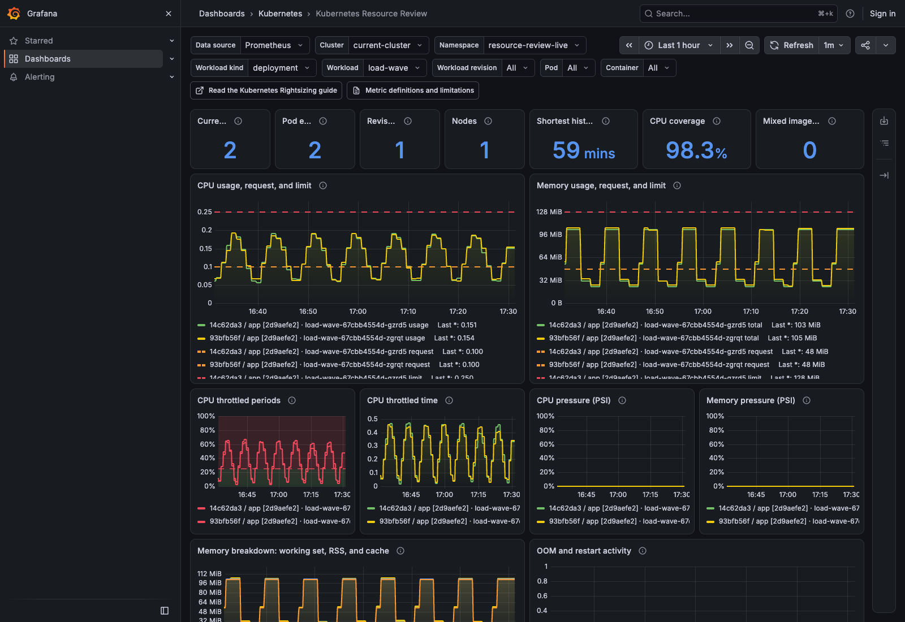

# Kubernetes Resource Review Mixin

> **Learn how to interpret the CPU, memory, and runtime evidence in this dashboard.**
> [Follow the review process in The Technical Guide to Kubernetes Rightsizing →](https://learnkube.com/kubernetes-rightsizing)

This repository includes a [Grafana dashboard](https://grafana.com/docs/grafana/latest/dashboards/) and [Prometheus recording rules](https://prometheus.io/docs/prometheus/latest/configuration/recording_rules/). They support the review process in the guide.

The dashboard lets you compare [Pods](https://kubernetes.io/docs/concepts/workloads/pods/). It shows CPU and memory use, throttling, pressure, restarts, and out-of-memory events alongside Kubernetes [resource requests and limits](https://kubernetes.io/docs/concepts/configuration/manage-resources-containers/). It shows what happened without choosing new resource values for you.

See [Metric definitions and limitations](docs/metrics.md) for the meaning and limits of each measurement.

## Dashboard Filters

- Cluster.
- Namespace.
- Workload.
- Workload revision.
- Pod.
- Container.
- Observation window.

## Dashboard Layout

All panels are visible without expanding any sections. Graphs come first, followed by tables with exact values.



### Context and evidence quality

- Current Pods and Pod executions.
- Revisions and nodes.
- Shortest CPU history and sample coverage.
- Revision/container groups with mixed immutable images.

### Resource graphs

- CPU usage with request and limit overlays.
- Total memory with request and limit overlays.
- CPU throttled-period percentage.
- CPU throttled time.
- CPU and memory pressure when PSI metrics exist.
- Working set, RSS, and cache as separate, unstacked lines.
- OOM and restart activity in rolling intervals.

### Configuration and replica comparison

- Current revision, image, requests, limits, and history.
- Per-Pod CPU average, p95, maximum, request differences, throttling, and pressure.
- Per-Pod memory maxima, OOM events, restarts, and `OOMKilled` state.
- Pod and node identity remain visible instead of one workload average.

### Revision review

The review table shows one row for each workload revision and container:

- Current requests and limits.
- CPU p95 and maximum.
- Memory maximum.
- Absolute and percentage differences from requests.
- Replica count.
- Observation duration.
- OOM, restart, throttling, and pressure signals.
- Missing evidence warnings.

The runtime activity chart uses rolling intervals of at least four minutes. The tables keep event totals for the whole selected window.

## Try it locally

`make dev` needs [Docker](https://docs.docker.com/get-started/docker-overview/), [kind](https://kind.sigs.k8s.io/), [Helm](https://helm.sh/docs/), [kubectl](https://kubernetes.io/docs/reference/kubectl/), [curl](https://curl.se/docs/), and [GNU Make](https://www.gnu.org/software/make/manual/make.html).

```bash
cd resource-review-mixin
make dev

🚀 Creating kind cluster: resource-review-mixin
📦 Installing kube-prometheus-stack 91.4.0
📊 Installing the mixin and sample workload
   ↳ prometheusrule.monitoring.coreos.com/resource-review-mixin created
   ↳ configmap/resource-review-dashboard created
   ↳ namespace/resource-review-test created
   ↳ deployment.apps/review-sample created
   ↳ deployment.apps/failure-sample created
   ↳ deployment.apps/unconfigured-sample created
   ↳ Waiting for deployment "review-sample" rollout to finish: 0 of 2 updated replicas are available...
   ↳ Waiting for deployment "review-sample" rollout to finish: 1 of 2 updated replicas are available...
   ↳ deployment "review-sample" successfully rolled out

✅ Development environment is ready.
   Grafana:    http://127.0.0.1:3000/d/learnk8s-resource-review/kubernetes-resource-review
   Prometheus: http://127.0.0.1:9090
   Cluster:    resource-review-mixin (kind-resource-review-mixin)

ℹ️  Data will appear after Prometheus has collected the first samples.
🧹 Remove everything with: make dev-down
```

The command creates a dedicated cluster and installs Prometheus, Grafana, the dashboard, and the recording rules. It also starts sample workloads and prints links to Grafana and Prometheus. Open **Kubernetes Resource Review** in the **Kubernetes** folder.

Run `make dev` again to update the development cluster. The command keeps that cluster and reapplies the generated recording rules and dashboard ConfigMap.

Use `make dev-open` to open Grafana in your browser:

```bash
make dev-open
🌐 Opening Grafana in your default browser...
```

To remove the cluster, run:

```bash
make dev-down
```

## Install it in a cluster

`make dev` installs [`kube-prometheus-stack`](https://github.com/prometheus-community/helm-charts/tree/main/charts/kube-prometheus-stack), including the required Prometheus Operator `PrometheusRule` CRD. Before you install this project in another cluster, make sure that the cluster has the same CRD. Prometheus needs Kubernetes object details from [kube-state-metrics](https://github.com/kubernetes/kube-state-metrics). It also needs container CPU and memory measurements from [cAdvisor](https://github.com/google/cadvisor). Metrics Server is not required.

The `kube-prometheus-stack` chart drops `container_cpu_cfs_throttled_seconds_total` from its cAdvisor scrape by default. The [included Helm values](kube-prometheus-stack-values.yaml) keep this metric so the **CPU throttled time** graph has data, while leaving the chart's other cAdvisor filters in place. Merge these values into the values used to install or upgrade your monitoring stack.

CPU and memory [Pressure Stall Information (PSI)](https://docs.kernel.org/accounting/psi.html) metrics are optional. When a node or cAdvisor version does not expose them, the dashboard continues to work and shows the pressure evidence as unavailable rather than zero. Check the tested versions and required measurements in [Compatibility and required metrics](docs/compatibility.md).

`make validate` checks which tools are available and downloads missing tools to `.tools/bin`. It does not change system directories. Each download uses a fixed version and must match the SHA-256 checksum in this repository. Downloads need `curl`, `tar`, and a SHA-256 command (`sha256sum` or `shasum`). The setup also needs [GNU Make](https://www.gnu.org/software/make/manual/make.html). It supports Linux and macOS on amd64 and arm64.

Review [config.libsonnet](config.libsonnet), then create and check the files:

```bash
make validate

🔧 Checking validation tools
   ↳ Jsonnet tools: found
   ↳ promtool: found
   ↳ Pint: found
   ↳ dashboard-linter: found
   ↳ kubeconform: found
   ↳ jq: found
✅ Validation tools are ready.
🔎 Validating source and generated files
   ↳ Generating the dashboard, rules, and Kubernetes files
   ↳ Checking Jsonnet formatting
   ↳ Checking Jsonnet source
   ↳ Checking configuration variants
   ↳ Checking Prometheus rules
   ↳ Checking the dashboard JSON, queries, and panels
   ↳ Checking Kubernetes files

✅ Validation passed.
```

`make validate` rebuilds the dashboard, Prometheus rules, and Kubernetes files. It then checks their formatting, queries, tests, and Kubernetes fields. After it passes, make sure that the committed files match the current Jsonnet source. `make check-generated` creates the files in a temporary directory and compares them with the committed copies:

```bash
make check-generated

🔧 Checking validation tools
   ↳ Jsonnet tools: found
   ↳ promtool: found
   ↳ Pint: found
   ↳ dashboard-linter: found
   ↳ kubeconform: found
   ↳ jq: found
✅ Validation tools are ready.
🔄 Checking committed generated files
✅ Committed generated files match the source
```

`make validate` creates a [PrometheusRule](https://prometheus-operator.dev/docs/api-reference/api/#monitoring.coreos.com/v1.PrometheusRule) and a [ConfigMap](https://kubernetes.io/docs/concepts/configuration/configmap/). Before you save them in the cluster, use the [Kubernetes API server](https://kubernetes.io/docs/reference/command-line-tools-reference/kube-apiserver/) to check them:

```bash
make cluster-check

🔎 Checking Kubernetes files with the API server
   ↳ PrometheusRule passed
   ↳ Dashboard ConfigMap passed

✅ Kubernetes API server check passed.
```

The command checks the files without saving them. If both pass, install the rules first, then the dashboard:

```bash
kubectl apply -f manifests/prometheus-rule.yaml
kubectl apply -f manifests/dashboard-configmap.yaml
```

The rules start saving measurements after installation. The dashboard cannot show Pod history from before that point.

If `kube-prometheus-stack` loads dashboards from ConfigMaps, use these Grafana settings so the dashboard appears in the **Kubernetes** folder:

```yaml
grafana:
  sidecar:
    dashboards:
      enabled: true
      folderAnnotation: grafana_folder
      provider:
        foldersFromFilesStructure: true
```

Without both folder settings, Grafana can place the dashboard in **General** instead.

## Change the settings

Edit [config.libsonnet](config.libsonnet) before you run `make validate`. Most installations need these settings:

[Kubernetes labels](https://kubernetes.io/docs/concepts/overview/working-with-objects/labels/) decide which rule or dashboard file a tool reads, while [Prometheus labels](https://prometheus.io/docs/concepts/data_model/#metric-names-and-labels) decide which measurements a query reads.

| Setting | Default | What it controls |
|---|---|---|
| `namespace` | `monitoring` | Where Kubernetes stores the rule and dashboard files |
| `prometheusRuleLabels.release` | `kube-prometheus-stack` | Which Prometheus installation reads the rules |
| `dashboardConfigMapLabels.grafana_dashboard` | `1` | Which Grafana installation reads the dashboard |
| `kubeStateMetricsSelector` | `job="kube-state-metrics"` | Which kube-state-metrics measurements the rules read |
| `cadvisorSelector` | `job="kubelet", metrics_path="/metrics/cadvisor"` | Which cAdvisor measurements the rules read |
| `defaultTimeRange` | `now-7d` | The time period shown when the dashboard opens |
| `showMultiCluster` | `false` | Whether Cluster is a metric-backed multi-cluster picker instead of a named single-cluster context value |
| `clusterLabel` | `cluster` | The label that names each cluster when the picker is enabled |
| `singleClusterName` | `current-cluster` | The Cluster value shown when source metrics do not carry a cluster label |

The time picker supports observation windows up to 30 days. Prometheus must keep at least 30 days of samples to fill the complete window. `make dev` sets retention to 31 days. The dashboard opens with the seven-day `defaultTimeRange`, and you can select **30d** in the time picker.

The same file includes optional warning colors, the book link, and links to standard Kubernetes dashboards. A warning color highlights a measured value. It does not recommend a change.

## How measurements stay with the right Pod

Kubernetes can reuse a Pod name after it removes the original Pod. The recording rules save each sample with its namespace, workload, revision, Pod name, and [Pod UID](https://kubernetes.io/docs/concepts/overview/working-with-objects/names/#uids). They also keep the node, container, image, and exact image ID. When the source metrics include a cluster label, the rules keep it too. In single-cluster mode, the dashboard shows the configured Cluster name if that label is absent.

The revision comes from the ReplicaSet name for [Deployment](https://kubernetes.io/docs/concepts/workloads/controllers/deployment/) updates and other ReplicaSet-owned Pods. It comes from the Job name when a [CronJob](https://kubernetes.io/docs/concepts/workloads/controllers/cron-jobs/) or another controller owns the [Job](https://kubernetes.io/docs/concepts/workloads/controllers/job/). Otherwise, it falls back to the Pod UID. The `revision_source` label records which source supplied the revision. These details keep an old measurement with its original Pod.

The rules also keep missing, zero, and unconfigured values separate. A missing value means Prometheus received no data. Zero is a measured value. Unconfigured means the Kubernetes object did not set a request or limit. [How the mixin keeps each sample with the right Pod](docs/architecture.md) explains the queries and how each Pod connects to its Kubernetes owner.

## Check a change

```bash
make validate
make check-generated
make integration-test
```

The first command creates the files and checks their format, queries, and Kubernetes fields. The second confirms that the committed files match the source.

`make integration-test` creates its own temporary kind cluster, installs `kube-prometheus-stack` and a sample workload, checks the Prometheus rules and Grafana dashboard with data from the running containers, and removes the cluster when the test finishes.

[Contributing](CONTRIBUTING.md) explains which commands each change needs. [Security](SECURITY.md) explains how to report a security problem without publishing its details.

## License

This project uses the [Apache License 2.0](LICENSE). See [Third-party licenses](THIRD_PARTY_LICENSES.md) for the libraries under `vendor/`.
