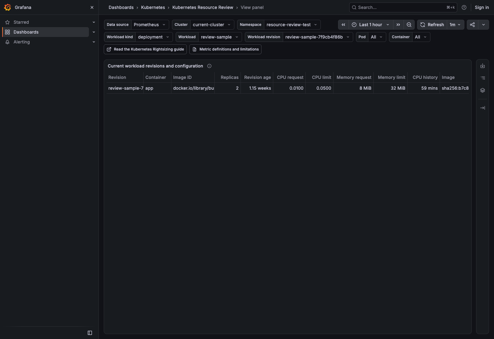
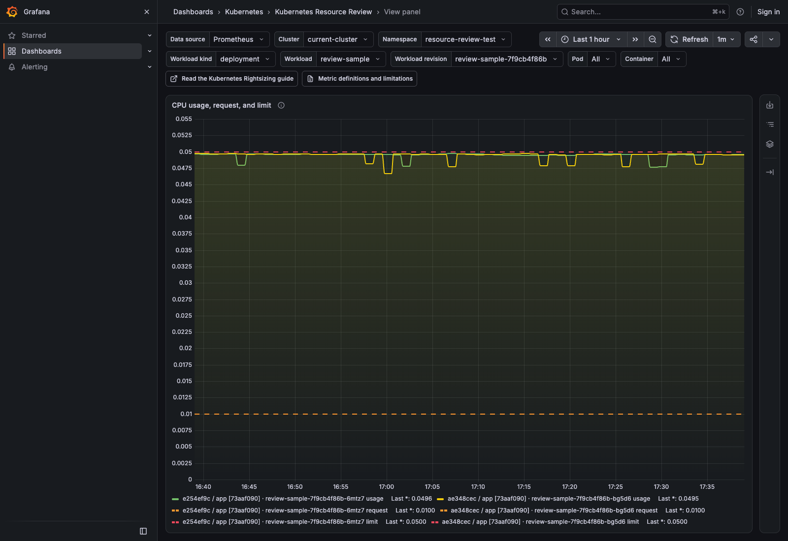
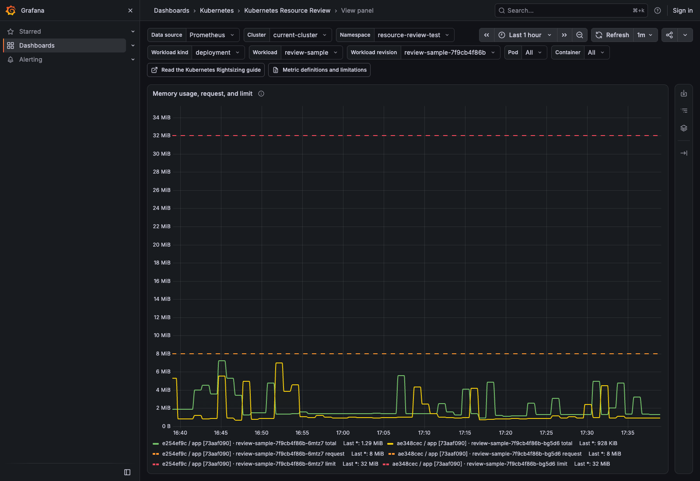
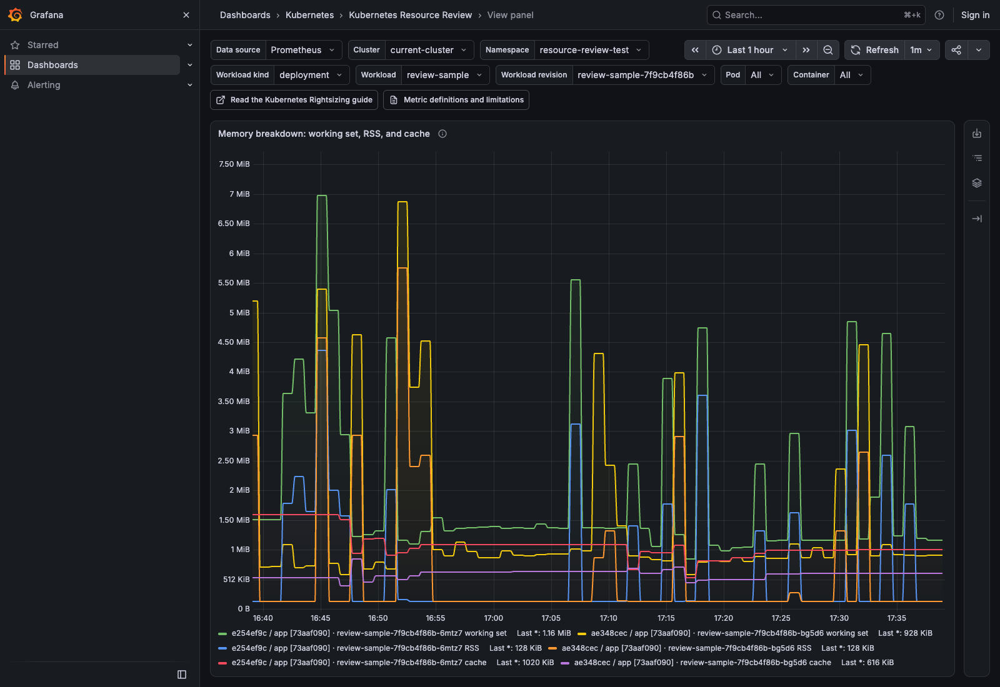
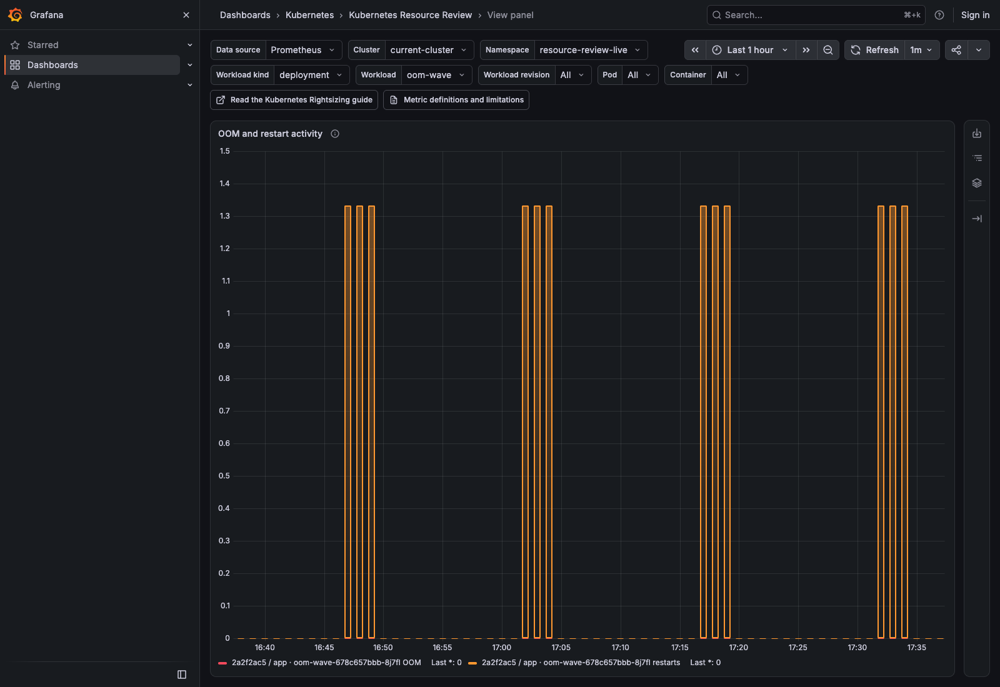

# How to read the dashboard

## Open the local example

`make dev` creates a Deployment named `review-sample` for this walkthrough. Open the [Kubernetes Resource Review dashboard](http://127.0.0.1:3000/d/learnk8s-resource-review/kubernetes-resource-review). Select `resource-review-test` as the namespace, `deployment` as the workload kind, and `review-sample` as the workload. Leave revision, Pod, and container set to `All`. Then choose `Last 1 hour` in the time picker.

The **Cluster** selector shows the configured single-cluster name. In multi-cluster mode, it lets you choose clusters from the recorded identity labels.


## Visual layout

All panels are visible without expanding any sections. Seven compact cards show context, coverage, and mixed-image groups. CPU and memory usage graphs sit side by side, with requests and limits on the same axes. Throttling and PSI graphs follow, then memory breakdown and runtime activity.

Tables for configuration, replica comparison, and revision review appear after the graphs. They show exact per-Pod percentiles, maxima, request differences, and event totals. If a graph has too many lines, use the Container filter to inspect one container across its replicas.


## Workload Context

This section accompanies Chapter 3, **Collecting Container, Runtime, and Kubernetes Metrics**, in **The Technical Guide to Kubernetes Rightsizing**. CPU and memory numbers need context: the workload, revision, image, current Pods, requests, limits, and available history. The local `review-sample` Deployment helps you track these details from Kubernetes through Prometheus to Grafana.



Start with the Deployment that `make dev` created:

```bash
kubectl get deployment review-sample \
  -n resource-review-test \
  -o custom-columns='NAME:.metadata.name,READY:.status.readyReplicas,DESIRED:.spec.replicas,IMAGE:.spec.template.spec.containers[0].image'

NAME            READY   DESIRED   IMAGE
review-sample   2       2         busybox:1.36@sha256:73aaf090f3d85aa34ee199857f03fa3a95c8ede2ffd4cc2cdb5b94e566b11662
```

The Deployment requests two Pods, and both are ready. The next command shows those two Pod objects:

```bash
kubectl get pods \
  -n resource-review-test \
  -l app=review-sample \
  -o custom-columns='NAME:.metadata.name,UID:.metadata.uid,NODE:.spec.nodeName,STATUS:.status.phase'

NAME                             UID                                    NODE                                  STATUS
review-sample-85d7d6b6c6-cnp4v   33652669-a8b2-4b76-ba65-7629becb5834   resource-review-mixin-control-plane   Running
review-sample-85d7d6b6c6-k2wxw   33d63449-e7b1-48f7-b55e-08a06865959b   resource-review-mixin-control-plane   Running
```

Kubernetes creates the Pod name suffixes and UIDs, so these values change when you recreate the local cluster. The **Add the State Kubernetes Knows** section in Chapter 3 explains why the UID matters. It lets Prometheus distinguish a replacement Pod from an older Pod with the same name.

Open [Prometheus](http://127.0.0.1:9090) and run this query. It returns one line per Pod with its name, UID, revision, node, container, and image:

```promql
resource_review:workload_revision_pod_container_info{
  namespace="resource-review-test",
  workload_type="deployment",
  workload="review-sample"
}
```


Here is how the information reaches the dashboard:

1. `kube-state-metrics` reads the Pod, container, and owner fields from the Kubernetes API.
2. Prometheus collects these four kube-state-metrics results:

```promql
kube_pod_info{job="kube-state-metrics", namespace="resource-review-test", pod=~"review-sample-.*"}
```

```promql
kube_pod_container_info{job="kube-state-metrics", namespace="resource-review-test", pod=~"review-sample-.*"}
```

```promql
kube_pod_owner{job="kube-state-metrics", namespace="resource-review-test", pod=~"review-sample-.*"}
```

```promql
kube_replicaset_owner{job="kube-state-metrics", namespace="resource-review-test", replicaset="review-sample-85d7d6b6c6"}
```

3. Every minute, Prometheus records the Pod name, UID, ReplicaSet, Deployment, node, container, and image as `resource_review:workload_revision_pod_container_info`.
4. Grafana wraps the four identity queries in the card sections with `count(...)` to produce the displayed numbers. Run those queries in Prometheus to see the Pod, revision, and node lines that Grafana counts.

**Shortest history** and **CPU coverage** use CPU measurements instead. cAdvisor measures CPU time for each container, and Prometheus collects `container_cpu_usage_seconds_total`. This query calculates average CPU use over five minutes:

```promql
sum by (namespace, pod, container) (
  rate(
    container_cpu_usage_seconds_total{
      job="kubelet",
      metrics_path="/metrics/cadvisor",
      namespace="resource-review-test",
      pod=~"review-sample-.*",
      container!="",
      container!="POD",
      image!=""
    }[5m]
  )
)
```

Every minute, Prometheus adds the matching Pod name, UID, revision, and node. It saves the result as `resource_review:container_cpu_usage_cores:rate5m`. **Shortest history** and **CPU coverage** count these saved CPU values.

CPU, throttling, and PSI rate rules filter out stale raw container series before grouping the rates. This prevents an older container's rate from attaching to a replacement Pod.

These calculations also include every Pod/container identity recorded during the selected window. A known identity without CPU samples contributes zero history and coverage. Its CPU usage remains unavailable.

Chapter 3 describes these two inputs in **Add the State Kubernetes Knows**: cAdvisor supplies the CPU measurement, while kube-state-metrics supplies the Pod UID, node, image, and owner that tell us which container produced it. The **How cAdvisor turns cgroups into container metrics** section follows the CPU measurement from Linux through the kubelet to Prometheus.

### Current workload revisions and configuration

The **Current workload revisions and configuration** table brings together Pod details and CPU history. It shows each revision, container, and image that Prometheus can see now. The filters identify the workload kind and name. Each row shows:

- Current revision and image.
- Replicas.
- Revision age.
- CPU and memory requests.
- CPU and memory limits.
- CPU history.

An older revision can appear in the revision summary if it ran during the selected time range. It leaves the current configuration table after its Pods are gone.

**Replicas** shows the number of different Pod UIDs in that row. Grafana gets this number from Prometheus. The Deployment can show a different number under `DESIRED` or `READY`.

**Revision age** starts when Kubernetes created the oldest of those current Pods. It is not the age of the Deployment itself. If the container has no CPU or memory request or limit, the matching cell stays empty instead of showing zero.

**CPU history** shows the shortest CPU history among the Pods in the row. If one Pod has an hour of data and another has twenty minutes, the table shows twenty minutes. That is all the history available to compare both Pods.

If a known Pod has no CPU samples, the row shows zero available observation history.

An older revision can have weeks of data while a new one has only a few minutes. The **Make Short Revision History Visible** section in Chapter 3 explains why combining these revisions hides that difference. The table shows revision age and available history beside requests and limits. If a row has only a few minutes of history, its values describe only those minutes.

Prometheus gets the workload kind, workload name, revision, container, image, image ID, requests, and limits from `kube-state-metrics`. It gets the length of the CPU history from the cAdvisor samples saved by the recording rule. Grafana places those values in the same row, but it does not use them to decide what the requests or limits should be.

### Current Pods

```promql
count by (cluster, namespace, pod, uid) (
  resource_review:workload_revision_pod_container_info{
    namespace=~"resource-review-test",
    workload_type=~"deployment",
    workload=~"review-sample",
    revision=~".*",
    pod=~".*",
    container=~".*"
  }
)
```

Prometheus returns two lines. One contains `pod="review-sample-85d7d6b6c6-cnp4v"` and its UID, and the other contains `pod="review-sample-85d7d6b6c6-k2wxw"` and its UID. Grafana counts these lines and shows **Current Pods = 2**.

The earlier `kubectl get pods` command reads current Pod objects directly from the Kubernetes API. It shows the same two names and UIDs. This confirms the value, but Grafana does not run that command.

| Dashboard | Prometheus query result |
|---|---|
|  |  |

### Pod executions

```promql
count by (cluster, namespace, pod, uid) (
  max_over_time(
    resource_review:workload_revision_pod_container_info{
      namespace=~"resource-review-test",
      workload_type=~"deployment",
      workload=~"review-sample",
      revision=~".*",
      pod=~".*",
      container=~".*"
    }[1h]
  )
)
```

This query looks back over the selected hour rather than only at Pods that exist now. Prometheus finds the same two Pod names and UIDs during that hour, so Grafana shows **Pod executions = 2**.

Once Kubernetes removes a Pod object, `kubectl` cannot list it. It therefore cannot show every Pod UID from the last hour. Prometheus keeps the earlier values and supplies this card.

The **Add the State Kubernetes Knows** section in Chapter 3 uses the same example. Kubernetes can reuse a Pod name, but the replacement gets a new UID. Prometheus can then count the old and new Pods separately during the selected hour.

| Dashboard | Prometheus query result |
|---|---|
|  |  |

### Revisions

Run this query in Prometheus:

```promql
count by (cluster, namespace, workload_type, workload, revision, revision_source) (
  max_over_time(
    resource_review:workload_revision_pod_container_info{
      namespace=~"resource-review-test",
      workload_type=~"deployment",
      workload=~"review-sample",
      revision=~".*",
      pod=~".*",
      container=~".*"
    }[1h]
  )
)
```

| Dashboard | Prometheus query result |
|---|---|
|  |  |

Both Pods have `workload="review-sample"`, `revision="review-sample-85d7d6b6c6"`, and `revision_source="replicaset"`. The query groups them on one line with the value `2`, because both Pods belong to that revision. Grafana counts that one revision line and shows **Revisions = 1**.

The current ReplicaSet can also be checked through the Kubernetes API:

```bash
kubectl get rs \
  -n resource-review-test \
  -l app=review-sample \
  -o custom-columns='NAME:.metadata.name,OWNER:.metadata.ownerReferences[0].name,DESIRED:.spec.replicas,READY:.status.readyReplicas'

NAME                       OWNER           DESIRED   READY
review-sample-85d7d6b6c6   review-sample   2         2
```

The **Keep workload revisions separate** section in Chapter 3 explains why the ReplicaSet matters. When a Deployment's Pod template changes, Kubernetes creates a new ReplicaSet and replacement Pods instead of changing the existing Pods. The Grafana card uses Prometheus because it can also retain revisions that disappeared during the selected hour.

### Nodes

Run this query in Prometheus:

```promql
count by (cluster, namespace, node) (
  max_over_time(
    resource_review:workload_revision_pod_container_info{
      namespace=~"resource-review-test",
      workload_type=~"deployment",
      workload=~"review-sample",
      revision=~".*",
      pod=~".*",
      container=~".*"
    }[1h]
  )
)
```

Both Pods have `node="resource-review-mixin-control-plane"`. The query groups them on one line with the value `2`, because two Pods ran on that node. Grafana counts that one node line and shows **Nodes = 1**.

You can also read the current Pod-to-node assignments through the Kubernetes API:

```bash
kubectl get pods \
  -n resource-review-test \
  -l app=review-sample \
  -o custom-columns='POD:.metadata.name,NODE:.spec.nodeName'

POD                              NODE
review-sample-85d7d6b6c6-cnp4v   resource-review-mixin-control-plane
review-sample-85d7d6b6c6-k2wxw   resource-review-mixin-control-plane
```

This confirms there is one current node. The Grafana card uses Prometheus so a node from earlier in the selected hour stays visible after its Pod disappears.

Chapter 3 compares three replicas in **Compare replicas before aggregating them**. One Pod runs on a busy node, does less work, and spends more time waiting than the two Pods on the idle node. The **Nodes** card tells you how many nodes are part of the selected hour, and the Pod tables later show which Pod ran on each node.

| Dashboard | Prometheus query result |
|---|---|
|  |  |

### Shortest history

```promql
min(
  count_over_time(
    resource_review:container_cpu_usage_cores:rate5m{
      namespace=~"resource-review-test",
      workload_type=~"deployment",
      workload=~"review-sample",
      revision=~".*",
      pod=~".*",
      container=~".*"
    }[1h]
  )
  or (
    0 * max_over_time(
      resource_review:workload_revision_pod_container_info{
        namespace=~"resource-review-test",
        workload_type=~"deployment",
        workload=~"review-sample",
        revision=~".*",
        pod=~".*",
        container=~".*"
      }[1h]
    )
  )
) * 60
```

Prometheus saved 60 CPU values for each Pod during the selected hour. Grafana takes the smaller count and multiplies it by the one-minute recording interval. The result is 3,600 seconds, which Grafana shows as **Shortest history = 1 hour**.

The Kubernetes API does not store this one-hour CPU history, so there is no matching `kubectl` command.

### CPU coverage

Run this query in Prometheus:

```promql
clamp_max(
  min(
    count_over_time(
      resource_review:container_cpu_usage_cores:rate5m{
        namespace=~"resource-review-test",
        workload_type=~"deployment",
        workload=~"review-sample",
        revision=~".*",
        pod=~".*",
        container=~".*"
      }[1h]
    )
    or (
      0 * max_over_time(
        resource_review:workload_revision_pod_container_info{
          namespace=~"resource-review-test",
          workload_type=~"deployment",
          workload=~"review-sample",
          revision=~".*",
          pod=~".*",
          container=~".*"
        }[1h]
      )
    )
  ) / 60,
  1
)
```

The selected hour contains 60 one-minute slots, and Prometheus has 60 CPU values for both Pods. The query divides the smaller count, 60, by the expected count, 60. Prometheus returns `1`. Grafana shows that `0–1` ratio as a percentage, so `1` becomes **CPU coverage = 100%**.

If one known Pod has no CPU samples, the smaller count is zero. The dashboard then shows **Shortest history = 0 seconds** and **CPU coverage = 0%**.

The Kubernetes API does not count Prometheus samples, so there is no matching `kubectl` command for this card either.

Chapter 3 explains both limits. **Sampling Trades Detail for Volume** shows how the sample count reveals a missing value. **Make Short Revision History Visible** explains why a few minutes of measurements can describe only those few minutes. The dashboard shows both the available time and the percentage.

| Dashboard | Prometheus query result |
|---|---|
|  |  |

Read the configuration table with the context cards. They show which revision and image are running, the requests and limits, and the available history. **Mixed image groups** counts revision/container groups with more than one known immutable image ID. Separate revisions do not count as one mixed group. Use the same observation window to compare the graphs and tables.

## CPU Evidence

### CPU usage, request, and limit

The **CPU usage, request, and limit** graph draws CPU usage across the selected hour. Dashed orange lines show each Pod's request, and dashed red lines show its limit. CPU usage is measured in cores. One core means one CPU-second used during one wall-clock second. As **Measure CPU time received** explains in Chapter 3, the calculation starts with the total in `container_cpu_usage_seconds_total`. A five-minute [`rate()`](https://prometheus.io/docs/prometheus/latest/querying/functions/#rate) then shows how quickly that total increased:

```promql
rate(container_cpu_usage_seconds_total[5m])
```

If this query returns `0.5`, the container used an average of half a CPU core during those five minutes. A spike that lasts only a few seconds looks smaller after averaging over five minutes.



### p95 and maximum CPU usage

The **CPU usage, throttling, and pressure by Pod and node** table calculates p95 and maximum separately for each Pod UID. **CPU p95** is the value that 95 percent of the samples stayed at or below. **CPU max** is the highest sampled five-minute rate. As **Sampling Trades Detail for Volume** explains in Chapter 3, these samples show the busiest interval Prometheus recorded. They cannot reconstruct a shorter burst between scrapes.


### CPU request and limit

The **CPU usage, request, and limit** graph shows configured values alongside usage. Kubernetes uses the request to schedule the Pod. The limit sets the CPU quota that can make the container wait. **Interpret usage against the CPU request and limit** in Chapter 3 uses a `500m` request, a one-core limit, and `0.8` cores of usage. That container used more than its request but stayed within its limit. The dashboard makes the same comparison for the selected Pod and revision.

### Difference between the request and p95 usage

The book compares CPU usage with the request to show whether the container used more or less CPU than Kubernetes reserved for it. The CPU replica comparison table includes **CPU request**, **Request − p95**, and **Difference %** for this comparison:

```text
difference       = request - p95 CPU
difference ratio = difference / request
```

If the request is `0.50` cores and p95 CPU is `0.60` cores, the difference is `-0.10` cores and the ratio is `-20%`. A negative value means p95 CPU exceeded the request during this hour. It does not mean that the request needs a change. If the request is missing or zero, the dashboard leaves both difference cells empty.

### CPU throttled-period percentage

The **CPU throttled periods** graph answers the question asked in **Measure whether a CPU limit stopped the work** in Chapter 3. It divides `container_cpu_cfs_throttled_periods_total` by `container_cpu_cfs_periods_total` to show the percentage of quota periods in which the container used its quota and had to wait. A value of 20 percent means Linux throttled the container in 20 percent of the observed periods.

This percentage shows how often the limit stopped the container, but not how long it waited. The next graph shows that duration separately so the two values remain distinct.


### CPU throttled time

Throttled periods show how often the limit stopped the container. Chapter 3 then examines the duration when the percentage alone is not enough. The **CPU throttled time** graph shows seconds of throttled task time per wall-clock second. If two threads each wait for one second, the counter adds two seconds. The graph can therefore exceed one second per second. An empty graph means Prometheus did not receive `container_cpu_cfs_throttled_seconds_total` for the selected Pod and time range.


### CPU pressure when PSI metrics exist

Throttling shows that the CPU limit stopped the container. Ready-to-run work can also wait on a busy node without reaching a limit. **Measure whether work waited for CPU** in Chapter 3 uses PSI to distinguish these cases. The **CPU pressure (PSI)** graph shows the fraction of each five-minute window when at least one runnable task waited for CPU. The [Linux PSI interface](https://docs.kernel.org/accounting/psi.html) records that duration. It does not identify whether a CPU limit or node contention caused the wait.

PSI is optional. If the node does not expose the metric, the graph stays empty. The dashboard treats an empty result as unavailable data, not zero pressure.

**Connect CPU measurements to application work** brings the three signals together. Usage shows the CPU time the container received. Pressure shows when ready-to-run work waited. Throttling shows when the CPU limit stopped it. Application latency and throughput show whether those waits affected useful work.


## Memory Evidence

Chapter 3 begins **Measure memory from more than one angle** with a limitation: no single container metric shows "memory the application needs." The memory panels keep total memory, working set, RSS, and cache separate for the same Pod, container, and time period.

### Total container memory

The **Memory usage, request, and limit** graph shows everything charged to the container cgroup through `container_memory_usage_bytes`. Dashed orange and red lines show requests and limits. The total can include anonymous memory, file cache, and kernel memory. It is not the same as the application's heap. Chapter 3 begins **Compare total usage and working set** with this broad total before subtracting any cache.



### Working-set memory

The **Memory breakdown: working set, RSS, and cache** graph includes `container_memory_working_set_bytes`. As **Compare total usage and working set** explains, cAdvisor calculates it by subtracting inactive file cache from total usage:

```text
working set = total usage - inactive file cache
```

Active file cache and some kernel memory can remain in this value, even though Linux can reclaim them later. Working set is therefore not the same as application memory or memory that Linux can never reclaim.



### RSS and cache

Total and working-set memory show the broad level. **Separate resident memory from file cache** in Chapter 3 uses RSS and cache to explain part of that total. The memory breakdown graph keeps RSS and cache as separate, unstacked lines. RSS mainly shows resident anonymous memory, which often includes heaps and stacks. Cache shows file contents that Linux keeps in memory for reuse and can reclaim later. RSS plus cache does not always equal total memory because the cgroup can charge other memory too.

### Maximum values for the selected period

The memory replica comparison table shows the highest sampled total, working-set, RSS, and cache value for each Pod UID. These are the largest values Prometheus saved during the selected period. As **Sampling Trades Detail for Volume** explains in Chapter 3, a brief peak between scrapes can go unrecorded.

### Memory request and limit

The **Memory usage, request, and limit** graph overlays configured values on total memory. Kubernetes uses the request to schedule the Pod. The limit is the cgroup ceiling. If the container reaches it and Linux cannot reclaim enough memory, an allocation can fail and the kernel can kill a process. A request or limit that was not configured stays empty instead of appearing as zero.

### Memory pressure when PSI metrics exist

Memory pressure can slow a container before an allocation fails. **Measure time lost to memory pressure** in Chapter 3 uses PSI to measure waits while Linux searches for memory to reclaim. The **Memory pressure (PSI)** graph shows those waits as a percentage of each five-minute window. A container can stay within its limit and still show pressure. An OOM can also happen without a steady rise in pressure.

PSI is optional. When the node does not provide `container_pressure_memory_waiting_seconds_total`, the graph stays empty rather than showing a false zero.


### OOM and restart activity

The activity chart shows increases in the recorded OOM and restart counters over rolling windows. Each query sets a one-minute minimum step for the one-minute recording rules. Grafana chooses `$__rate_interval` from that step and the graph resolution, with a four-minute minimum. For longer observation windows, the interval grows to keep short activity visible between widely spaced graph points.

The windows overlap. Use the comparison and review tables for full-period event totals instead of adding the bars. Counter sampling shows approximate activity, not the exact time of each event. `OOMKilled` remains a separate termination-state value in the tables.



### cAdvisor OOM events

The **OOM events** column in the memory comparison table shows how many new events `container_oom_events_total` recorded during the selected period. **Record both sources of OOM evidence** in Chapter 3 uses the same counter to count allocation failures seen by cAdvisor. A value of `2` means cAdvisor recorded about two new OOM events for that Pod and container during the selected time.

### Kubernetes `OOMKilled` state

cAdvisor's counter is one part of the check. Kubernetes also stores the last termination reason for a container. The **OOMKilled** column shows `True` if Kubernetes reported `OOMKilled` during the selected period, and `False` if it reported another reason. An empty value means Prometheus did not receive the termination-state metric. `True` confirms an OOM kill, but it is not a full count. A later termination can replace the reason.

### Container restarts

The **Restarts** column shows how many times the container restarted during the selected period. That number does not explain the cause. Read it with the cAdvisor OOM event count and Kubernetes `OOMKilled` state. If the cause remains unclear, check Pod events and application logs.

## Replica Comparison

Chapter 3 reaches **Compare replicas before aggregating them** after attaching every measurement to its workload, revision, Pod, and node. It keeps replicas separate because Pods from one revision can receive different traffic or run on nodes with different levels of contention. The dashboard uses the same order. Identify each Pod first, then compare its CPU, memory, waiting, and failure values with the other replicas.

### Keep each Pod and node visible

Both comparison tables keep the **Pod** and **Node** columns visible. The recording rules also keep the Pod UID to distinguish a replacement Pod from an older Pod with the same name. The table uses the UID to separate rows, then hides that technical column.

Graph legends show short Pod UIDs and image IDs beside the Pod and container names. These labels distinguish reused Pod names and image changes. The query results keep the full identity labels.

The first table is **CPU usage, throttling, and pressure by Pod and node**. The second is **Memory, OOM events, and restarts by Pod and node**. Each row belongs to one Pod UID, node, and container from the selected revision.


### Compare usage, throttling, pressure, memory, OOM events, and restarts

The CPU table reads the same CPU recording rule three times over the selected period:

```promql
avg_over_time(resource_review:container_cpu_usage_cores:rate5m{namespace="resource-review-test", workload_type="deployment", workload="review-sample"}[$__range])

quantile_over_time(0.95, resource_review:container_cpu_usage_cores:rate5m{namespace="resource-review-test", workload_type="deployment", workload="review-sample"}[$__range])

max_over_time(resource_review:container_cpu_usage_cores:rate5m{namespace="resource-review-test", workload_type="deployment", workload="review-sample"}[$__range])
```

Prometheus calculates average, p95, and maximum CPU separately for every Pod UID. The same row shows the highest throttled-period percentage, throttled-time rate, and CPU-pressure percentage recorded during the selected period. **History** shows how many seconds of samples were available. **Coverage** compares the number received with the number expected from the one-minute recording interval.

The memory table shows average and maximum working-set memory for each Pod UID, plus total memory, RSS, and cache maxima. It also shows the highest five-minute memory-pressure percentage. `increase()` counts new cAdvisor OOM events and container restarts during the selected period. The `OOMKilled` column shows whether Kubernetes reported that last termination reason at any point in the period.


### Do not hide replica differences behind one average

The example in **Compare replicas before aggregating them** shows three Pods with different CPU use, waiting time, throughput, and latency. The Pod on the busy node completes less work and waits longer. Averaging its CPU value with the other two hides that difference.

The **Average CPU** and **Average working set** columns do not show workload averages. Each value comes from one Pod UID's samples. Replica Comparison does not add or average Pods together. A replica with higher throttling, pressure, memory use, OOM events, or restarts stays visible beside the others.

## Review Table


Chapter 3 keeps workload revisions separate, compares their Pods, then brings the results into one summary. The **Review Table** uses the same order. Each row shows one workload revision and container, keeping different revisions apart.

### Image population

**Image population** counts unique, nonempty immutable image IDs seen during the selected period. It shows **1 known image**, **Mixed images**, or **Unknown images**. Different tags for the same immutable image do not increase the count.

A **Mixed images** row combines evidence from several images. Its request, CPU, and memory maxima can come from different Pods and images. The differences describe that combined population, not one exact image. The current configuration table and Pod-level evidence keep the individual image IDs.

### Current requests and limits

The **CPU request**, **CPU limit**, **Memory request**, and **Memory limit** columns show the last configured value Prometheus recorded during the selected period. This keeps a completed or replaced revision readable after its Pods are gone. An empty cell means the request or limit was not configured. It does not mean zero.

Chapter 3's **Interpret usage against the CPU request and limit** section explains why both CPU values stay beside usage: the request affects placement and CPU weight, while the limit sets the quota that can stop the container. The same row keeps the memory request and hard memory limit beside the memory maximum.

### CPU p95 and maximum

Prometheus calculates p95 and maximum CPU separately for every Pod. The table keeps the highest replica result in the revision row. This shows the busiest Pod instead of averaging it away. CPU values use cores, so `0.5` means half a CPU core.

The p95 comes from five-minute CPU rates collected during the selected period. As **Sampling Trades Detail for Volume** explains in Chapter 3, these values describe collected intervals, not microsecond-scale CPU spikes.

### Memory maximum

**Memory max** is the highest total container memory value seen on any Pod in the revision during the selected period. It uses total cgroup memory rather than working set. Chapter 3's **Measure memory from more than one angle** section explains why the two are not interchangeable: total memory includes all memory charged to the cgroup, while working set subtracts inactive file cache.

Use the Memory Evidence section when you need the working-set, RSS, and cache values behind this summary.

### Absolute and percentage differences from requests

The table compares each request with the busiest value kept in the row:

```text
CPU absolute difference from request    = CPU request - CPU p95
CPU percentage difference from request  = (CPU request - CPU p95) / CPU request

Memory absolute difference from request    = memory request - memory maximum
Memory percentage difference from request  = (memory request - memory maximum) / memory request
```

A negative result means usage exceeded the request. For example, a `0.50`-core request and `0.60`-core p95 produce `-0.10` cores and `-20%`. These numbers describe the selected period. They do not show that a request change is safe. If the request is missing or zero, the percentage cell stays empty to avoid division by zero.

### Replica count

**Replicas** counts different Pod UIDs seen during the selected period. It includes replaced and short-lived Pods. This count can therefore exceed the Deployment's current desired or ready replica count.

As **Compare replicas before aggregating them** explains in Chapter 3, each Pod is measured separately first. Only the highest CPU or memory value appears in this revision row. Use Replica Comparison to find which Pod and node produced the difference.

### CPU history

**CPU history** shows the shortest CPU history among the Pods in the row. Prometheus counts each Pod's one-minute CPU rule samples and multiplies the smallest count by 60 seconds. If one Pod has seven days of samples and another has ten minutes, the row shows ten minutes.

Chapter 3's **Make Short Revision History Visible** section explains why CPU history stays next to p95. A p95 from a few minutes cannot describe the same range of workload cycles as one from several days. Missing scrapes also shorten this value.

### OOM, restart, throttling, and pressure signals

The row adds cAdvisor OOM events and Kubernetes container restarts for all Pods in the revision. **OOMKilled** is true when Kubernetes reported that state for at least one of those Pods. **Record both sources of OOM evidence** explains why these checks stay separate. The cAdvisor counter and Kubernetes' last termination reason do not contain the same history.

**Throttled-period percentage**, **Throttled-time rate**, **CPU pressure**, and **Memory pressure** keep the highest replica value seen during the selected period. Throttling shows that a CPU limit stopped work. Pressure shows that work waited for CPU or memory. PSI cells stay empty on nodes that do not publish PSI metrics.

### Missing evidence warnings

`0` and an empty cell mean different things. Zero means Prometheus received the metric and measured zero. An empty cell means no matching sample was available. The **Warnings** column counts different warning types for the row, not how many Pods raised the same warning.

The count covers these cases:

- CPU usage is unavailable.
- CPU throttled-period or throttled-time data is unavailable.
- Total memory, working set, RSS, or cache is unavailable.
- Optional CPU or memory PSI data is unavailable.
- A CPU or memory request or limit is not configured.
- The cAdvisor OOM counter or Kubernetes restart counter is unavailable.
- A CPU or memory request is zero, so its percentage cannot be calculated.
- No shared controller revision was found, so the Pod UID is used as the revision.
- One revision and container contains more than one immutable image ID.
- Prometheus collected less than 80 percent of the expected CPU samples.

The warning count helps distinguish missing values from measured zeros. Use the CPU, memory, and replica comparison panels to inspect the Pod-level values behind the row.

## Find the Pod behind each value

Every value keeps labels that show its source. If a CPU or memory value looks unusual, these labels identify the exact workload, revision, Pod execution, node, container, and image:

```text
cluster
namespace
workload_type
workload
revision
revision_source
pod
uid
node
container
image
image_id
```

For example, one `checkout` container can have these labels:

```text
namespace       = shop
workload_type   = deployment
workload        = checkout
revision        = checkout-7d8f
revision_source = replicaset
pod             = checkout-7d8f-k9m2p
uid             = 2cb4...
node            = worker-2
container       = app
image           = registry.example/checkout:2.4
image_id        = registry.example/checkout@sha256:8ad1...
```

- **`cluster` and `namespace`** locate the workload in Kubernetes.
- **`workload_type` and `workload`** identify the controller, such as the `checkout` Deployment.
- **`revision`** identifies the rollout. For a Deployment, this is usually the name of the ReplicaSet.
- **`revision_source`** tells you how the mixin found the revision.
- **`pod` and `uid`** identify the Pod. The name is easy to read, and the UID identifies that exact Pod execution.
- **`node` and `container`** show where the container ran and which container produced the value.
- **`image` and `image_id`** show the configured image and the exact image content used by the container. Two Pods can use the same tag and still have different image IDs.

The restart counter keeps the Pod UID and container but leaves out `image` and `image_id`. Its cumulative history stays continuous when an image changes within the same Pod.

The dashboard also combines increases from older image-labeled restart series by Pod UID and container. This prevents duplicate rows during an upgrade.

If `revision_source` is `pod_uid`, the mixin did not find a shared controller revision and used the Pod UID instead. Three Pod UIDs therefore appear as three revision rows, even if they belong to the same workload.

## Find the same value in Prometheus

Grafana reads dashboard values from these recording rules. To inspect a series in Prometheus, copy a rule name and add the labels shown in Grafana to narrow the result:

```promql
resource_review:container_cpu_usage_cores:rate5m{
  namespace="shop",
  workload="checkout"
}
```

| Recording rule | Unit | What it records |
|---|---:|---|
| `resource_review:workload_revision_pod_info` | labels | Workload, revision, Pod UID, and node |
| `resource_review:workload_revision_pod_container_info` | labels | Pod labels plus container, image, and immutable image ID |
| `resource_review:workload_revision_pod_created_timestamp_seconds` | Unix seconds | Pod creation time |
| `resource_review:container_cpu_usage_cores:rate5m` | CPU cores | Average CPU use over five minutes |
| `resource_review:container_cpu_throttled_periods:ratio_rate5m` | ratio | Fraction of CPU quota periods that included throttling |
| `resource_review:container_cpu_throttled_seconds:rate5m` | seconds/second | Throttled task time per wall-clock second |
| `resource_review:container_cpu_pressure_waiting:ratio_rate5m` | ratio | Optional CPU waiting time from PSI |
| `resource_review:container_memory_usage_bytes` | bytes | Total cgroup memory |
| `resource_review:container_memory_working_set_bytes` | bytes | cAdvisor working set |
| `resource_review:container_memory_rss_bytes` | bytes | Resident anonymous memory |
| `resource_review:container_memory_cache_bytes` | bytes | File cache charged to the cgroup |
| `resource_review:container_memory_pressure_waiting:ratio_rate5m` | ratio | Optional memory waiting time from PSI |
| `resource_review:container_cpu_request_cores` | CPU cores | Configured CPU request |
| `resource_review:container_cpu_limit_cores` | CPU cores | Configured CPU limit |
| `resource_review:container_memory_request_bytes` | bytes | Configured memory request |
| `resource_review:container_memory_limit_bytes` | bytes | Configured memory limit |
| `resource_review:container_restarts_total` | counter | Restart count for the exact Pod UID and container |
| `resource_review:container_last_termination_oomkilled` | flag | Whether the latest termination reason was `OOMKilled` |
| `resource_review:container_oom_events_total` | counter | cAdvisor OOM count for the exact Pod UID and container |
| `resource_review:workload_revision_pod_container_qos_class` | label | [Kubernetes QoS class](https://kubernetes.io/docs/concepts/workloads/pods/pod-qos/) for the Pod |
| `resource_review:container_last_terminated_reason` | label | Latest known termination reason |
| `resource_review:container_last_terminated_exit_code` | exit code | Latest known terminated exit code |

The first rules identify the Pod and container. Prometheus then [evaluates the remaining rules in order](https://prometheus.io/docs/prometheus/latest/configuration/recording_rules/) and adds Pod identity and workload labels to the CPU, memory, restart, and OOM values.

## Check application metrics before changing resources

A low CPU or memory value does not automatically justify a lower request or limit. This dashboard shows how the container used its resources.

Before you change a request or limit, note the Pod, revision, node, and time range that produced the value. Run the same workload in a load test. Change one value at a time. Then compare latency, throughput, and error rate before and after the change.
