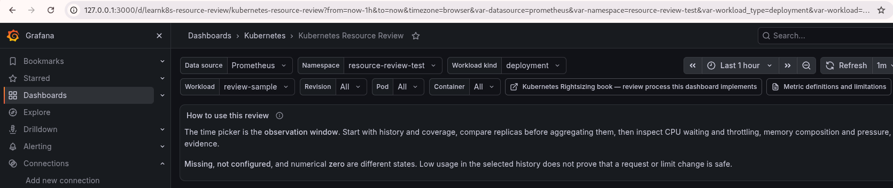
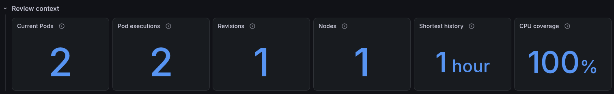
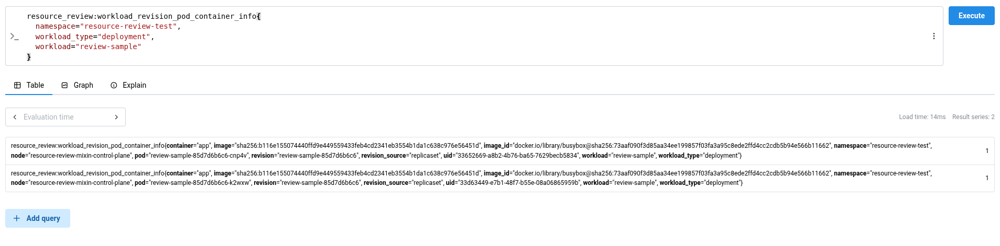
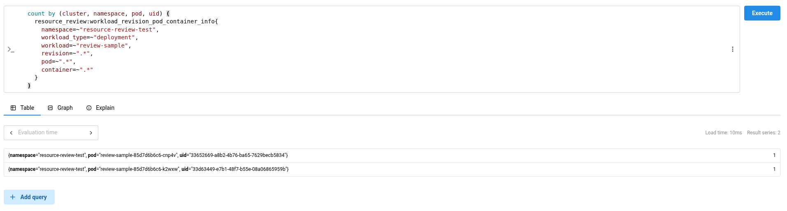
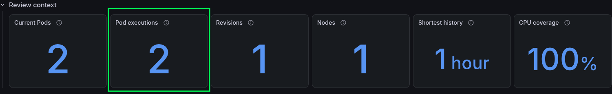
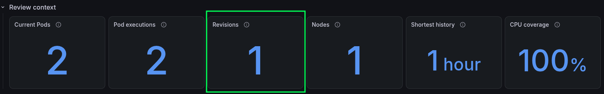
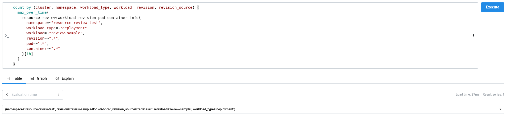
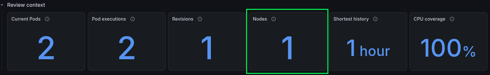
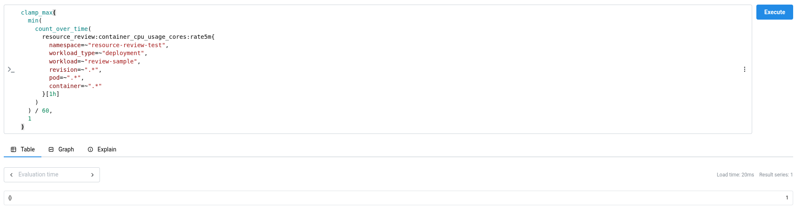

# How to read the dashboard

## Open the local example

`make dev` creates a Deployment called `review-sample` for this walkthrough. Open the [Kubernetes Resource Review dashboard](http://127.0.0.1:3000/d/learnk8s-resource-review/kubernetes-resource-review), select `resource-review-test` as the namespace, `deployment` as the workload kind, and `review-sample` as the workload. Leave revision, Pod, and container set to `All`, then choose `Last 1 hour` in the time picker.



## Start with Review context



Start with the Deployment that `make dev` created:

```bash
kubectl get deployment review-sample \
  -n resource-review-test \
  -o custom-columns='NAME:.metadata.name,READY:.status.readyReplicas,DESIRED:.spec.replicas,IMAGE:.spec.template.spec.containers[0].image'

NAME            READY   DESIRED   IMAGE
review-sample   2       2         busybox:1.36@sha256:73aaf090f3d85aa34ee199857f03fa3a95c8ede2ffd4cc2cdb5b94e566b11662
```

The Deployment asks for two Pods, and both are ready. The next command shows the two Pod objects behind that result:

```bash
kubectl get pods \
  -n resource-review-test \
  -l app=review-sample \
  -o custom-columns='NAME:.metadata.name,UID:.metadata.uid,NODE:.spec.nodeName,STATUS:.status.phase'

NAME                             UID                                    NODE                                  STATUS
review-sample-85d7d6b6c6-cnp4v   33652669-a8b2-4b76-ba65-7629becb5834   resource-review-mixin-control-plane   Running
review-sample-85d7d6b6c6-k2wxw   33d63449-e7b1-48f7-b55e-08a06865959b   resource-review-mixin-control-plane   Running
```

Kubernetes creates the Pod name suffixes and UIDs, so they will change when you recreate the local cluster.

Open [Prometheus](http://127.0.0.1:9090) and run this query. It returns one line for each Pod and shows its name, UID, revision, node, container, and image:

```promql
resource_review:workload_revision_pod_container_info{
  namespace="resource-review-test",
  workload_type="deployment",
  workload="review-sample"
}
```



Grafana does not run `kubectl` or read the Kubernetes API. The information reaches the dashboard in these steps:

1. kube-state-metrics reads the Pod, container, and owner fields from the Kubernetes API.
2. Prometheus collects these four kube-state-metrics results:

   ```promql
   kube_pod_info{job="kube-state-metrics", namespace="resource-review-test", pod=~"review-sample-.*"}
   ```

   ```promql
   kube_pod_container_info{job="kube-state-metrics", namespace="resource-review-test", pod=~"review-sample-.*"}
   ```

   ```promql
   kube_pod_owner{job="kube-state-metrics", namespace="resource-review-test", pod=~"review-sample-.*"}
   ```

   ```promql
   kube_replicaset_owner{job="kube-state-metrics", namespace="resource-review-test", replicaset="review-sample-85d7d6b6c6"}
   ```

3. Every minute, Prometheus puts the Pod name, UID, ReplicaSet, Deployment, node, container, and image on one line and saves it as `resource_review:workload_revision_pod_container_info`.
4. Grafana adds one more `count(...)` around the first four queries below to turn their lines into the numbers shown on the cards. Run the queries as written here in Prometheus so you can see the Pod, revision, and node lines that Grafana counts.

**Shortest history** and **CPU coverage** use CPU measurements instead. cAdvisor measures the CPU time used by each running container, Prometheus collects `container_cpu_usage_seconds_total`, and this query calculates the average CPU use over five minutes:

```promql
sum by (namespace, pod, container) (
  rate(
    container_cpu_usage_seconds_total{
      job="kubelet",
      metrics_path="/metrics/cadvisor",
      namespace="resource-review-test",
      pod=~"review-sample-.*",
      container!="",
      container!="POD",
      image!=""
    }[5m]
  )
)
```

Every minute, Prometheus adds the matching Pod name, UID, revision, and node, then saves the result as `resource_review:container_cpu_usage_cores:rate5m`. **Shortest history** and **CPU coverage** count those saved CPU values.

### Current Pods

```promql
count by (cluster, namespace, pod, uid) (
  resource_review:workload_revision_pod_container_info{
    namespace=~"resource-review-test",
    workload_type=~"deployment",
    workload=~"review-sample",
    revision=~".*",
    pod=~".*",
    container=~".*"
  }
)
```

The Prometheus result has two lines. One line has `pod="review-sample-85d7d6b6c6-cnp4v"` and its UID, and the other has `pod="review-sample-85d7d6b6c6-k2wxw"` and its UID. Grafana counts those two lines and shows **Current Pods = 2**.

The earlier `kubectl get pods` command reads the current Pod objects directly from the Kubernetes API and shows the same two names and UIDs. It confirms the value, but Grafana does not run that command.

| Dashboard | Prometheus query result |
|---|---|
|  |  |

### Pod executions

```promql
count by (cluster, namespace, pod, uid) (
  max_over_time(
    resource_review:workload_revision_pod_container_info{
      namespace=~"resource-review-test",
      workload_type=~"deployment",
      workload=~"review-sample",
      revision=~".*",
      pod=~".*",
      container=~".*"
    }[1h]
  )
)
```

This query looks back over the selected hour instead of looking only at the Pods that exist now. Prometheus finds the same two Pod names and UIDs during that hour, so Grafana shows **Pod executions = 2**.

Kubernetes removes a Pod object after the Pod is deleted, so `kubectl` cannot list every Pod UID that appeared during the last hour. Prometheus keeps the earlier values and supplies this card.

| Dashboard | Prometheus query result |
|---|---|
|  |  |

### Revisions

Run this query in Prometheus:

```promql
count by (cluster, namespace, workload_type, workload, revision, revision_source) (
  max_over_time(
    resource_review:workload_revision_pod_container_info{
      namespace=~"resource-review-test",
      workload_type=~"deployment",
      workload=~"review-sample",
      revision=~".*",
      pod=~".*",
      container=~".*"
    }[1h]
  )
)
```

| Dashboard | Prometheus query result |
|---|---|
|  |  |

Both Pods have `workload="review-sample"`, `revision="review-sample-85d7d6b6c6"`, and `revision_source="replicaset"`. The query puts them on one line with the value `2`, meaning that two Pods belong to that revision. Grafana counts the one revision line and shows **Revisions = 1**.

The current ReplicaSet can also be checked through the Kubernetes API:

```bash
kubectl get rs \
  -n resource-review-test \
  -l app=review-sample \
  -o custom-columns='NAME:.metadata.name,OWNER:.metadata.ownerReferences[0].name,DESIRED:.spec.replicas,READY:.status.readyReplicas'

NAME                       OWNER           DESIRED   READY
review-sample-85d7d6b6c6   review-sample   2         2
```

This confirms the one current ReplicaSet. The Grafana card still comes from Prometheus because Prometheus can also keep revisions that disappeared during the selected hour.

### Nodes

Run this query in Prometheus:

```promql
count by (cluster, namespace, node) (
  max_over_time(
    resource_review:workload_revision_pod_container_info{
      namespace=~"resource-review-test",
      workload_type=~"deployment",
      workload=~"review-sample",
      revision=~".*",
      pod=~".*",
      container=~".*"
    }[1h]
  )
)
```

Both Pods have `node="resource-review-mixin-control-plane"`. The query puts them on one line with the value `2`, meaning that two Pods ran on that node. Grafana counts the one node line and shows **Nodes = 1**.

The current Pod-to-node assignments can also be checked through the Kubernetes API:

```bash
kubectl get pods \
  -n resource-review-test \
  -l app=review-sample \
  -o custom-columns='POD:.metadata.name,NODE:.spec.nodeName'

POD                              NODE
review-sample-85d7d6b6c6-cnp4v   resource-review-mixin-control-plane
review-sample-85d7d6b6c6-k2wxw   resource-review-mixin-control-plane
```

This confirms the one current node. The Grafana card comes from Prometheus so that a node used earlier in the selected hour remains visible after the Pod disappears.

| Dashboard | Prometheus query result |
|---|---|
|  |  |

### Shortest history

```promql
min(
  count_over_time(
    resource_review:container_cpu_usage_cores:rate5m{
      namespace=~"resource-review-test",
      workload_type=~"deployment",
      workload=~"review-sample",
      revision=~".*",
      pod=~".*",
      container=~".*"
    }[1h]
  )
) * 60
```

Prometheus saved 60 CPU values for each Pod during the selected hour. Grafana takes the Pod with the smaller count and multiplies its 60 values by the one-minute recording interval. The result is 3,600 seconds, which Grafana shows as **Shortest history = 1 hour**.

The Kubernetes API does not store this one-hour CPU history, so there is no matching `kubectl` command.

### CPU coverage

Run this query in Prometheus:

```promql
clamp_max(
  min(
    count_over_time(
      resource_review:container_cpu_usage_cores:rate5m{
        namespace=~"resource-review-test",
        workload_type=~"deployment",
        workload=~"review-sample",
        revision=~".*",
        pod=~".*",
        container=~".*"
      }[1h]
    )
  ) / 60,
  1
)
```

The selected hour contains 60 one-minute slots, and Prometheus has 60 CPU values for both Pods. The query divides the smaller count, 60, by the expected count, 60, so Prometheus returns `1`. Grafana displays that `0–1` ratio as a percentage, which turns `1` into **CPU coverage = 100%**.

The Kubernetes API does not count Prometheus samples, so there is no matching `kubectl` command for this card either.

| Dashboard | Prometheus query result |
|---|---|
|  |  |

Together, the six cards say that two Pods ran during the selected hour, both belong to one ReplicaSet, both ran on one node, and Prometheus has a complete hour of CPU values for both Pods. The next section can therefore compare their CPU and memory values without a Pod with less data changing the result.

## Compare Pods before reading the summary

<!-- Add a screenshot of CPU by Pod execution and Memory and failures by Pod execution here. -->

The **CPU by Pod execution** table reads the same CPU recording rule three times over the selected hour:

```promql
avg_over_time(resource_review:container_cpu_usage_cores:rate5m{namespace="resource-review-test", workload_type="deployment", workload="review-sample"}[1h])

quantile_over_time(0.95, resource_review:container_cpu_usage_cores:rate5m{namespace="resource-review-test", workload_type="deployment", workload="review-sample"}[1h])

max_over_time(resource_review:container_cpu_usage_cores:rate5m{namespace="resource-review-test", workload_type="deployment", workload="review-sample"}[1h])
```

The queries return one row for each of the two Pod UIDs:

| Pod | Average CPU | p95 CPU | Maximum CPU |
|---|---:|---:|---:|
| `review-sample-85d7d6b6c6-cnp4v` | 49.63m | 49.98m | 49.99m |
| `review-sample-85d7d6b6c6-k2wxw` | 49.50m | 49.93m | 49.95m |

The two Pods used almost the same CPU during this hour. The table still keeps them separate because a single workload average would hide the difference if one Pod later used much more CPU than the other. The revision summary is calculated only after these per-Pod values exist.

## Check CPU usage, limits, and throttling

CPU usage is measured in cores, and one core means one CPU-second used during one wall-clock second. The recording rule starts with the five-minute [`rate()`](https://prometheus.io/docs/prometheus/latest/querying/functions/#rate) of cumulative CPU time:

```promql
rate(container_cpu_usage_seconds_total[5m])
```

If CPU usage spikes for a few seconds, the five-minute average makes that spike look smaller.

- **Average CPU** is the arithmetic mean of the CPU samples in the selected range. If the samples are `0.10`, `0.20`, and `0.45` cores, the average is `0.25` cores. This value does not contain the highest individual sample; read p95 and maximum CPU for that value.

- **p95 CPU** is the value that 95 percent of the recorded samples stayed at or below. If average CPU is `0.25` and p95 is `0.70`, 95 percent of the samples are at or below `0.70` cores. The highest 5 percent of samples are excluded from p95 and remain visible in Maximum CPU.

- **Maximum CPU** is the highest sampled five-minute rate in the selected range. It cannot reconstruct a shorter burst that happened between scrapes.

- **CPU request** is the amount Kubernetes uses when it schedules the Pod. The value comes from the Pod specification rather than CPU measurements. If maximum CPU is `0.60` cores and the request is `0.50` cores, the difference is `-0.10` because usage exceeded the request by one tenth of a core.

```text
difference       = request - usage statistic
difference ratio = difference / request
```

The ratio disappears when the request is missing or configured as zero.

- **CPU limit** is the container's CPU quota. The “CPU maximum / limit” bar divides the highest sampled usage by that configured value. A bar at 80 percent means the highest sampled five-minute rate reached 80 percent of the limit. It does not promise 20 percent of safe headroom because a shorter burst may be absent from the samples.

- **Throttled periods** measures how many CPU quota periods included throttling. A value of 20 percent means the Linux CPU controller stopped the container in 20 percent of the observed quota periods. A 20 percent throttled-period ratio and a 20 percent latency increase describe unrelated measurements.

- **Throttled time** measures accumulated task time stopped by the quota. Several tasks can wait at once, which can raise the rate above one second per second. Both throttling metrics prove that the quota was active, while latency, throughput, or another service-level signal must show the application impact.

- **CPU pressure** uses Pressure Stall Information, or PSI, to measure time that runnable tasks spent waiting for CPU. The [Linux PSI interface](https://docs.kernel.org/accounting/psi.html) reports waiting time without assigning a cause. Compare the same time window with CPU throttling, the CPU limit, node pressure, and application latency.

An empty panel means Prometheus received no `container_pressure_cpu_waiting_seconds_total` series matching the selected labels; run the raw query to confirm whether the source metric exists.

## Check memory usage and limits

The mixin records four separate cgroup memory values: total usage, working set, RSS, and cache. Compare them for the same Pod, container, and time range; they measure different parts of cgroup memory accounting.

- **Total memory** is everything charged to the container cgroup. It can include anonymous memory, file cache, and other kernel-accounted memory.

- **Working set** is commonly cAdvisor's total usage minus inactive file cache. It estimates recently active memory rather than “memory the application can never release.”

- **RSS** mainly represents resident anonymous memory. Application heaps and stacks often contribute here, but RSS is still a cgroup value rather than a language-runtime heap measurement.

- **Cache** represents file content retained for reuse, and the kernel may reclaim some of it when the node needs memory. RSS plus cache does not always equal total usage because these values come from different parts of cgroup accounting.

- **Memory request** affects scheduling, while **memory limit** is the cgroup ceiling that can lead to an OOM event when memory cannot be reclaimed. The “Memory maximum / limit” bar compares the highest sampled total memory with the configured limit. An absent bar means the limit or memory evidence is unavailable.

## Check restarts and OOM kills

If `Last terminated reason` is `OOMKilled`, the most recent recorded termination happened because the container ran out of memory. This value only describes the latest termination, and a newer termination replaces it.

`Restarts` tells you how many times the container restarted during the selected period, but it does not record the cause of each restart. `OOM events` shows how many out-of-memory events cAdvisor recorded during the same period. Check the Pod events and application logs when you need the cause of earlier restarts.

## Understand zero and empty values

`0` and an empty cell mean different things. If the throttling table shows `0`, Prometheus received the metric and measured no throttling during the selected time range. If the cell is empty, Prometheus has no matching data for that Pod and time range.

The data may be missing because the node does not expose the metric, Prometheus missed the scrape, or the Pod did not run during that period. The dashboard leaves missing data empty instead of displaying a false `0`.

The warning table explains what is missing or why a value could not be calculated:

- **CPU or memory usage unavailable:** Prometheus has no usage samples.
- **CPU or memory pressure unavailable:** the node does not expose the optional pressure metric.
- **Request or limit not configured:** the container does not have that value in its resource configuration.
- **OOM or restart counter unavailable:** Prometheus has no matching counter for the container.
- **Request is zero:** the dashboard cannot divide by zero to calculate the ratio.
- **Revision falls back to Pod UID:** the mixin could not find a shared controller revision.
- **Multiple immutable images:** one revision contains more than one image ID.
- **CPU sample coverage below 80 percent:** Prometheus collected fewer than 80 percent of the expected samples.

## Find the Pod behind each value

Every value keeps the labels that show where it came from. If one CPU or memory value looks unusual, these labels identify the exact workload, revision, Pod execution, node, container, and image:

```text
cluster
namespace
workload_type
workload
revision
revision_source
pod
uid
node
container
image
image_id
```

For example, one `checkout` container can have these labels:

```text
namespace       = shop
workload_type   = deployment
workload        = checkout
revision        = checkout-7d8f
revision_source = replicaset
pod             = checkout-7d8f-k9m2p
uid             = 2cb4...
node            = worker-2
container       = app
image           = registry.example/checkout:2.4
image_id        = registry.example/checkout@sha256:8ad1...
```

- **`cluster` and `namespace`** locate the workload in Kubernetes.
- **`workload_type` and `workload`** identify the controller, such as the `checkout` Deployment.
- **`revision`** identifies the rollout. For a Deployment, this is usually the ReplicaSet name.
- **`revision_source`** tells you how the mixin found the revision.
- **`pod` and `uid`** identify the Pod. The name is easy to read, while the UID identifies that exact Pod execution.
- **`node` and `container`** show where the container ran and which container produced the value.
- **`image` and `image_id`** show the configured image and the exact image content used by the container. Two Pods can use the same tag and still have different image IDs.

If `revision_source` is `pod_uid`, the mixin could not find a shared controller revision and used the Pod UID instead. Three Pod UIDs then appear as three revision rows, even when they belong to the same workload.

## Find the same value in Prometheus

Grafana reads the values in this dashboard from the recording rules below. You can copy a rule name into Prometheus when you want to inspect its series and add the same labels shown in Grafana to narrow the result:

```promql
resource_review:container_cpu_usage_cores:rate5m{
  namespace="shop",
  workload="checkout"
}
```

| Recording rule | Unit | What it records |
|---|---:|---|
| `resource_review:workload_revision_pod_info` | labels | Workload, revision, Pod UID, and node |
| `resource_review:workload_revision_pod_container_info` | labels | Pod labels plus container, image, and immutable image ID |
| `resource_review:workload_revision_pod_created_timestamp_seconds` | Unix seconds | Pod creation time |
| `resource_review:container_cpu_usage_cores:rate5m` | CPU cores | Average CPU use over five minutes |
| `resource_review:container_cpu_throttled_periods:ratio_rate5m` | ratio | Fraction of CPU quota periods that included throttling |
| `resource_review:container_cpu_throttled_seconds:rate5m` | seconds/second | Throttled task time per wall-clock second |
| `resource_review:container_cpu_pressure_waiting:ratio_rate5m` | ratio | Optional CPU waiting time from PSI |
| `resource_review:container_memory_usage_bytes` | bytes | Total cgroup memory |
| `resource_review:container_memory_working_set_bytes` | bytes | cAdvisor working set |
| `resource_review:container_memory_rss_bytes` | bytes | Resident anonymous memory |
| `resource_review:container_memory_cache_bytes` | bytes | File cache charged to the cgroup |
| `resource_review:container_memory_pressure_waiting:ratio_rate5m` | ratio | Optional memory waiting time from PSI |
| `resource_review:container_cpu_request_cores` | CPU cores | Configured CPU request |
| `resource_review:container_cpu_limit_cores` | CPU cores | Configured CPU limit |
| `resource_review:container_memory_request_bytes` | bytes | Configured memory request |
| `resource_review:container_memory_limit_bytes` | bytes | Configured memory limit |
| `resource_review:container_restarts_total` | counter | Restart count for the exact Pod UID and container |
| `resource_review:container_last_termination_oomkilled` | flag | Whether the latest termination reason was `OOMKilled` |
| `resource_review:container_oom_events_total` | counter | cAdvisor OOM count for the exact Pod UID and container |
| `resource_review:workload_revision_pod_container_qos_class` | label | [Kubernetes QoS class](https://kubernetes.io/docs/concepts/workloads/pods/pod-qos/) for the Pod |
| `resource_review:container_last_terminated_reason` | label | Latest known termination reason |
| `resource_review:container_last_terminated_exit_code` | exit code | Latest known terminated exit code |

The first rules identify the Pod and container. Prometheus then [evaluates the remaining rules in order](https://prometheus.io/docs/prometheus/latest/configuration/recording_rules/) and adds the same labels to the CPU, memory, restart, and OOM values.

## Check application metrics before changing resources

A low CPU or memory value does not automatically mean that you should lower the request or limit. This dashboard shows how the container used its resources.

Before changing a request or limit, note the Pod, revision, node, and time range that produced the value. Run the same workload in a load test, change one value at a time, and compare latency, throughput, and error rate before and after the change.
