# How to read the dashboard

## Open the local example

`make dev` creates a Deployment called `review-sample` for this walkthrough. Open the [Kubernetes Resource Review dashboard](http://127.0.0.1:3000/d/learnk8s-resource-review/kubernetes-resource-review), select `resource-review-test` as the namespace, `deployment` as the workload kind, and `review-sample` as the workload. Leave revision, Pod, and container set to `All`, then choose `Last 1 hour` in the time picker.


## Workload Context

This section accompanies Chapter 3, **Collecting Container, Runtime, and Kubernetes Metrics**, in **The Technical Guide to Kubernetes Rightsizing**. The chapter explains why a CPU or memory number is useful only when you can also see which workload and revision produced it, which image is running, how many Pods Prometheus can see now, what requests and limits are set, and how much history Prometheus has. The local `review-sample` Deployment lets you follow those details from Kubernetes to Prometheus and then to Grafana.

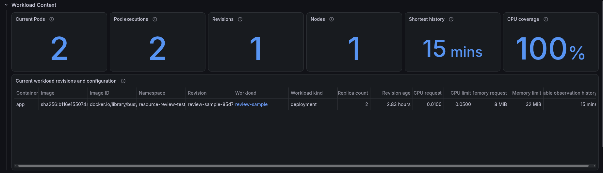

Start with the Deployment that `make dev` created:

```bash
kubectl get deployment review-sample \
  -n resource-review-test \
  -o custom-columns='NAME:.metadata.name,READY:.status.readyReplicas,DESIRED:.spec.replicas,IMAGE:.spec.template.spec.containers[0].image'

NAME            READY   DESIRED   IMAGE
review-sample   2       2         busybox:1.36@sha256:73aaf090f3d85aa34ee199857f03fa3a95c8ede2ffd4cc2cdb5b94e566b11662
```

The Deployment asks for two Pods, and both are ready. The next command shows the two Pod objects behind that result:

```bash
kubectl get pods \
  -n resource-review-test \
  -l app=review-sample \
  -o custom-columns='NAME:.metadata.name,UID:.metadata.uid,NODE:.spec.nodeName,STATUS:.status.phase'

NAME                             UID                                    NODE                                  STATUS
review-sample-85d7d6b6c6-cnp4v   33652669-a8b2-4b76-ba65-7629becb5834   resource-review-mixin-control-plane   Running
review-sample-85d7d6b6c6-k2wxw   33d63449-e7b1-48f7-b55e-08a06865959b   resource-review-mixin-control-plane   Running
```

Kubernetes creates the Pod name suffixes and UIDs, so they will change when you recreate the local cluster. The **Add the State Kubernetes Knows** section in Chapter 3 explains that the UID lets Prometheus tell a recreated Pod from an older Pod that used the same name.

Open [Prometheus](http://127.0.0.1:9090) and run this query. It returns one line for each Pod and shows its name, UID, revision, node, container, and image:

```promql
resource_review:workload_revision_pod_container_info{
  namespace="resource-review-test",
  workload_type="deployment",
  workload="review-sample"
}
```

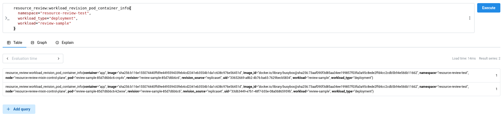

The information reaches the dashboard in these steps:

1. `kube-state-metrics` reads the Pod, container, and owner fields from the Kubernetes API.
2. Prometheus collects these four kube-state-metrics results:

```promql
kube_pod_info{job="kube-state-metrics", namespace="resource-review-test", pod=~"review-sample-.*"}
```

```promql
kube_pod_container_info{job="kube-state-metrics", namespace="resource-review-test", pod=~"review-sample-.*"}
```

```promql
kube_pod_owner{job="kube-state-metrics", namespace="resource-review-test", pod=~"review-sample-.*"}
```

```promql
kube_replicaset_owner{job="kube-state-metrics", namespace="resource-review-test", replicaset="review-sample-85d7d6b6c6"}
```

1. Every minute, Prometheus puts the Pod name, UID, ReplicaSet, Deployment, node, container, and image on one line and saves it as `resource_review:workload_revision_pod_container_info`.
2. Grafana adds one more `count(...)` around the first four queries below to turn their lines into the numbers shown on the cards. Run the queries as written here in Prometheus so you can see the Pod, revision, and node lines that Grafana counts.

**Shortest history** and **CPU coverage** use CPU measurements instead. cAdvisor measures the CPU time used by each running container, Prometheus collects `container_cpu_usage_seconds_total`, and this query calculates the average CPU use over five minutes:

```promql
sum by (namespace, pod, container) (
  rate(
    container_cpu_usage_seconds_total{
      job="kubelet",
      metrics_path="/metrics/cadvisor",
      namespace="resource-review-test",
      pod=~"review-sample-.*",
      container!="",
      container!="POD",
      image!=""
    }[5m]
  )
)
```

Every minute, Prometheus adds the matching Pod name, UID, revision, and node, then saves the result as `resource_review:container_cpu_usage_cores:rate5m`. **Shortest history** and **CPU coverage** count those saved CPU values.

Chapter 3 describes these two inputs in **Add the State Kubernetes Knows**: cAdvisor supplies the CPU measurement, while kube-state-metrics supplies the Pod UID, node, image, and owner that tell us which container produced it. The **How cAdvisor turns cgroups into container metrics** section follows the CPU measurement from Linux through the kubelet to Prometheus.

### Current workload revisions and configuration

Now that you have seen where the Pod details and CPU samples come from, you can read them together in the **Workload Context** table. The table has one row for each revision, container, and image that Prometheus can see now. Each row shows:

- Workload kind and name.
- Current revision and image.
- Replica count.
- Revision age.
- CPU and memory requests.
- CPU and memory limits.
- Available observation history.

An older revision may still appear later in the revision summary if it ran during the selected time range, but it does not appear in this table after its Pods are gone.

**Replica count** is the number of different Pod UIDs in that row. Grafana gets this number from Prometheus. The Deployment may show a different number under `DESIRED` or `READY`.

**Revision age** starts when the oldest of those current Pods was created, so it is not the age of the Deployment itself. If Kubernetes has no CPU or memory request or limit for the container, the matching cell stays empty instead of showing zero.

**Available observation history** shows the shortest CPU history among the Pods in the row. For example, if one Pod has an hour of data and another has only twenty minutes, the table shows twenty minutes because that is all the history available for comparing both Pods.

An old revision may have weeks of data while a new revision has only a few minutes. The **Make Short Revision History Visible** section in Chapter 3 explains why combining those revisions would hide this difference. The table shows the revision age and available history beside the request and limit. When a row has only a few minutes of history, you know its values come from those few minutes.

Prometheus gets the workload kind, workload name, revision, container, image, image ID, requests, and limits from `kube-state-metrics`. It gets the length of the CPU history from the cAdvisor samples saved by the recording rule. Grafana places those values in the same row, but it does not use them to decide what the requests or limits should be.

### Current Pods

```promql
count by (cluster, namespace, pod, uid) (
  resource_review:workload_revision_pod_container_info{
    namespace=~"resource-review-test",
    workload_type=~"deployment",
    workload=~"review-sample",
    revision=~".*",
    pod=~".*",
    container=~".*"
  }
)
```

The Prometheus result has two lines. One line has `pod="review-sample-85d7d6b6c6-cnp4v"` and its UID, and the other has `pod="review-sample-85d7d6b6c6-k2wxw"` and its UID. Grafana counts those two lines and shows **Current Pods = 2**.

The earlier `kubectl get pods` command reads the current Pod objects directly from the Kubernetes API and shows the same two names and UIDs. It confirms the value, but Grafana does not run that command.

| Dashboard | Prometheus query result |
|---|---|
| 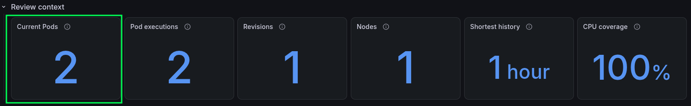 |  |

### Pod executions

```promql
count by (cluster, namespace, pod, uid) (
  max_over_time(
    resource_review:workload_revision_pod_container_info{
      namespace=~"resource-review-test",
      workload_type=~"deployment",
      workload=~"review-sample",
      revision=~".*",
      pod=~".*",
      container=~".*"
    }[1h]
  )
)
```

This query looks back over the selected hour instead of looking only at the Pods that exist now. Prometheus finds the same two Pod names and UIDs during that hour, so Grafana shows **Pod executions = 2**.

Kubernetes removes a Pod object after the Pod is deleted, so `kubectl` cannot list every Pod UID that appeared during the last hour. Prometheus keeps the earlier values and supplies this card.

The **Add the State Kubernetes Knows** section in Chapter 3 uses the same example: Kubernetes may reuse a Pod name, but the new Pod gets a new UID. Prometheus can then count the old and new Pods separately during the selected hour.

| Dashboard | Prometheus query result |
|---|---|
|  | 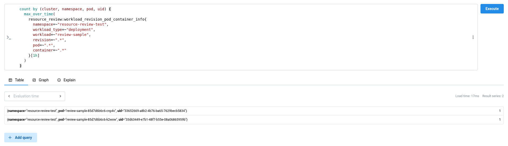 |

### Revisions

Run this query in Prometheus:

```promql
count by (cluster, namespace, workload_type, workload, revision, revision_source) (
  max_over_time(
    resource_review:workload_revision_pod_container_info{
      namespace=~"resource-review-test",
      workload_type=~"deployment",
      workload=~"review-sample",
      revision=~".*",
      pod=~".*",
      container=~".*"
    }[1h]
  )
)
```

| Dashboard | Prometheus query result |
|---|---|
|  |  |

Both Pods have `workload="review-sample"`, `revision="review-sample-85d7d6b6c6"`, and `revision_source="replicaset"`. The query puts them on one line with the value `2`, meaning that two Pods belong to that revision. Grafana counts the one revision line and shows **Revisions = 1**.

The current ReplicaSet can also be checked through the Kubernetes API:

```bash
kubectl get rs \
  -n resource-review-test \
  -l app=review-sample \
  -o custom-columns='NAME:.metadata.name,OWNER:.metadata.ownerReferences[0].name,DESIRED:.spec.replicas,READY:.status.readyReplicas'

NAME                       OWNER           DESIRED   READY
review-sample-85d7d6b6c6   review-sample   2         2
```

The **Keep workload revisions separate** section in Chapter 3 explains why the ReplicaSet matters: when a Deployment's Pod template changes, Kubernetes creates a new ReplicaSet and replacement Pods instead of changing the existing Pods. The Grafana card still comes from Prometheus because Prometheus can also keep revisions that disappeared during the selected hour.
### Nodes

Run this query in Prometheus:

```promql
count by (cluster, namespace, node) (
  max_over_time(
    resource_review:workload_revision_pod_container_info{
      namespace=~"resource-review-test",
      workload_type=~"deployment",
      workload=~"review-sample",
      revision=~".*",
      pod=~".*",
      container=~".*"
    }[1h]
  )
)
```

Both Pods have `node="resource-review-mixin-control-plane"`. The query puts them on one line with the value `2`, meaning that two Pods ran on that node. Grafana counts the one node line and shows **Nodes = 1**.

The current Pod-to-node assignments can also be checked through the Kubernetes API:

```bash
kubectl get pods \
  -n resource-review-test \
  -l app=review-sample \
  -o custom-columns='POD:.metadata.name,NODE:.spec.nodeName'

POD                              NODE
review-sample-85d7d6b6c6-cnp4v   resource-review-mixin-control-plane
review-sample-85d7d6b6c6-k2wxw   resource-review-mixin-control-plane
```

This confirms the one current node. The Grafana card comes from Prometheus so that a node used earlier in the selected hour remains visible after the Pod disappears.

Chapter 3 compares three replicas in **Compare replicas before aggregating them**. One Pod runs on a busy node, does less work, and spends more time waiting than the two Pods on the idle node. The **Nodes** card tells you how many nodes are part of the selected hour, and the Pod tables later show which Pod ran on each node.

| Dashboard | Prometheus query result |
|---|---|
|  | 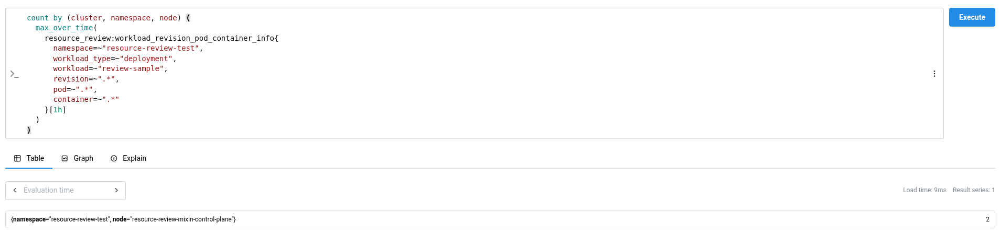 |

### Shortest history

```promql
min(
  count_over_time(
    resource_review:container_cpu_usage_cores:rate5m{
      namespace=~"resource-review-test",
      workload_type=~"deployment",
      workload=~"review-sample",
      revision=~".*",
      pod=~".*",
      container=~".*"
    }[1h]
  )
) * 60
```

Prometheus saved 60 CPU values for each Pod during the selected hour. Grafana takes the Pod with the smaller count and multiplies its 60 values by the one-minute recording interval. The result is 3,600 seconds, which Grafana shows as **Shortest history = 1 hour**.

The Kubernetes API does not store this one-hour CPU history, so there is no matching `kubectl` command.

### CPU coverage

Run this query in Prometheus:

```promql
clamp_max(
  min(
    count_over_time(
      resource_review:container_cpu_usage_cores:rate5m{
        namespace=~"resource-review-test",
        workload_type=~"deployment",
        workload=~"review-sample",
        revision=~".*",
        pod=~".*",
        container=~".*"
      }[1h]
    )
  ) / 60,
  1
)
```

The selected hour contains 60 one-minute slots, and Prometheus has 60 CPU values for both Pods. The query divides the smaller count, 60, by the expected count, 60, so Prometheus returns `1`. Grafana displays that `0–1` ratio as a percentage, which turns `1` into **CPU coverage = 100%**.

The Kubernetes API does not count Prometheus samples, so there is no matching `kubectl` command for this card either.

Chapter 3 explains both limits. **Sampling Trades Detail for Volume** shows how the sample count reveals a missing value. **Make Short Revision History Visible** explains why a few minutes of measurements can describe only those few minutes. The dashboard shows both the available time and the percentage.

| Dashboard | Prometheus query result |
|---|---|
| 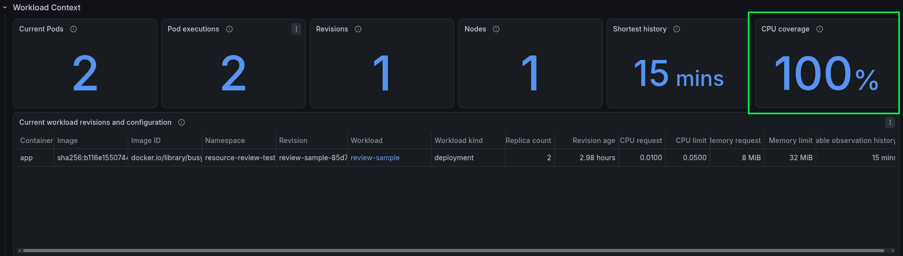 |  |

Read the table and the six cards together. They show which revision and image are running, the requests and limits set on the container, and how much data Prometheus has for the two Pods. They also show that both Pods belong to the same ReplicaSet and ran on the same node during the selected hour. Keep the same hour selected and open **CPU Evidence**. Its graphs and table show what happened to each Pod without mixing their measurements.

## CPU Evidence

### CPU usage over time

The **CPU usage over time** graph draws CPU usage across the selected hour. CPU usage is measured in cores, and one core means one CPU-second used during one wall-clock second. This follows **Measure CPU time received** in Chapter 3: start with the running total in `container_cpu_usage_seconds_total`, then use a five-minute [`rate()`](https://prometheus.io/docs/prometheus/latest/querying/functions/#rate) to see how quickly it increased:

```promql
rate(container_cpu_usage_seconds_total[5m])
```

If this query returns `0.5`, the container used half a CPU core on average during those five minutes. A spike that lasts only a few seconds looks smaller after it is averaged over five minutes.

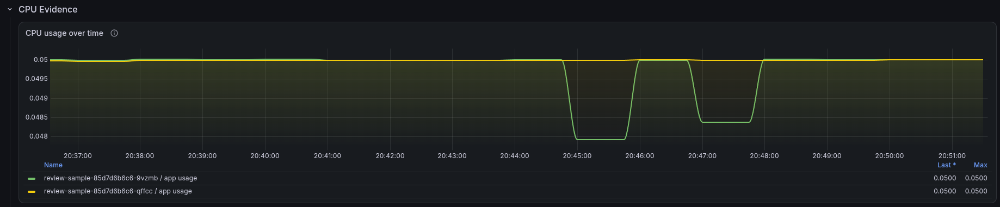

### p95 and maximum CPU usage

The **p95 and maximum CPU usage** table calculates both values separately for each Pod UID. **p95 CPU** is the value that 95 percent of the samples stayed at or below. **Maximum CPU** is the highest sampled five-minute rate. As **Sampling Trades Detail for Volume** explains in Chapter 3, these samples show the busiest interval Prometheus recorded, but they cannot rebuild a shorter burst that happened between scrapes.

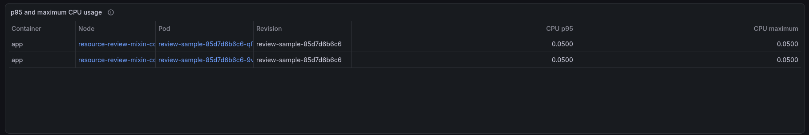

### CPU request and limit

The **CPU request and limit** graph places the two configured values beside each other. The request is the amount Kubernetes uses when it schedules the Pod, while the limit is the quota that can stop the container from running. **Interpret usage against the CPU request and limit** in Chapter 3 uses a container with a `500m` request, a one-core limit, and `0.8` cores of usage: it used more than its request but remained below its limit. The dashboard keeps the same comparison with the selected Pod and revision.

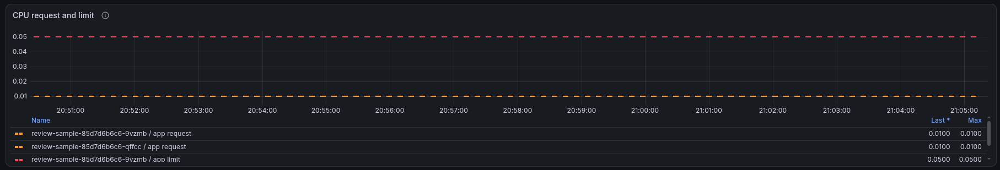

### Difference between the request and p95 usage

The book first compares CPU usage with the request to show whether the container used more or less CPU than Kubernetes reserved for it. The **Difference between the request and p95 usage** table continues that comparison with the same request and p95 shown in the CPU Evidence panels:

```text
difference       = request - p95 CPU
difference ratio = difference / request
```

If the request is `0.50` cores and p95 CPU is `0.60` cores, the difference is `-0.10` cores and the ratio is `-20%`. The negative value means p95 CPU was above the request during this hour; it does not mean the request should be changed. The dashboard leaves both difference cells empty when the request is missing or set to zero.

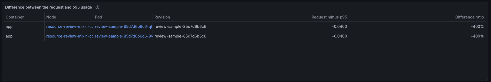

### CPU throttled-period percentage

The **CPU throttled-period percentage** graph answers the question asked in **Measure whether a CPU limit stopped the work** in Chapter 3. It divides `container_cpu_cfs_throttled_periods_total` by `container_cpu_cfs_periods_total` to show the percentage of quota periods in which the container used its quota and had to wait. A value of 20 percent means Linux throttled the container in 20 percent of the observed periods.

This percentage shows how often the limit stopped the container, but it does not show how long the container had to wait. The next graph keeps that waiting time separate so the two values are not mistaken for the same measurement.

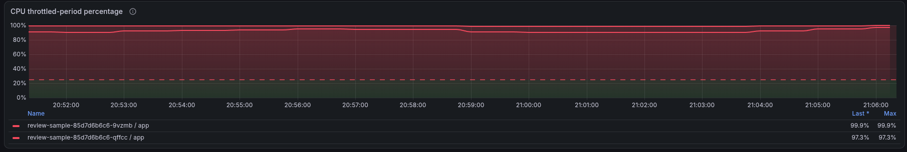

### CPU throttled time

After using throttled periods to show how often the limit stopped the container, Chapter 3 says to check how long the throttling lasted when the percentage alone is not enough. The **CPU throttled time** graph shows that duration for each second. If two threads are both held back for one second, the counter adds two seconds, so the graph can rise above one second per second. An empty graph means Prometheus did not receive `container_cpu_cfs_throttled_seconds_total` for the selected Pod and time range.

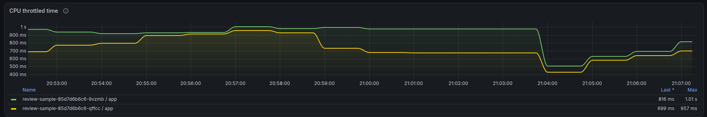

### CPU pressure when PSI metrics exist

Throttling shows that the CPU limit stopped the container, but ready-to-run work can also wait on a busy node without hitting a limit. **Measure whether work waited for CPU** in Chapter 3 uses PSI to keep those cases apart. The **CPU pressure when PSI metrics exist** graph measures the part of the selected time when at least one runnable task was waiting for CPU. The [Linux PSI interface](https://docs.kernel.org/accounting/psi.html) records the waiting time, but it does not say whether the CPU limit or a busy node caused the wait.

PSI is optional. When the node does not expose the metric, the graph stays empty. The dashboard treats that empty result as unavailable data rather than zero pressure.

This is the comparison made in **Connect CPU measurements to application work**: usage shows the CPU time the container received, pressure shows when ready-to-run work waited, and throttling shows when the CPU limit stopped it. Application latency and throughput are still needed to see whether that waiting affected useful work.

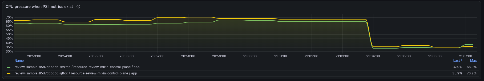

## Memory Evidence

Chapter 3 starts **Measure memory from more than one angle** with a warning: no single container metric means "memory the application needs." The Memory Evidence panels therefore keep total memory, working set, RSS, and cache separate for the same Pod, container, and selected time period.

### Total container memory

The **Total container memory** graph shows everything currently charged to the container cgroup through `container_memory_usage_bytes`. This can include anonymous memory, file cache, and memory used by the kernel, so the value is not the same as the application's heap. Chapter 3 begins **Compare total usage and working set** with this broad total before removing any cache.

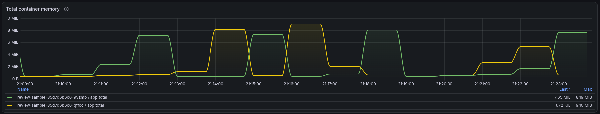

### Working-set memory

The **Working-set memory** graph shows `container_memory_working_set_bytes`. As **Compare total usage and working set** explains, cAdvisor calculates it by subtracting inactive file cache from total usage:

```text
working set = total usage - inactive file cache
```

Active file cache and some kernel memory can remain in this value even though Linux may reclaim them later. Working set is therefore not the same as application memory or memory that Linux can never reclaim.

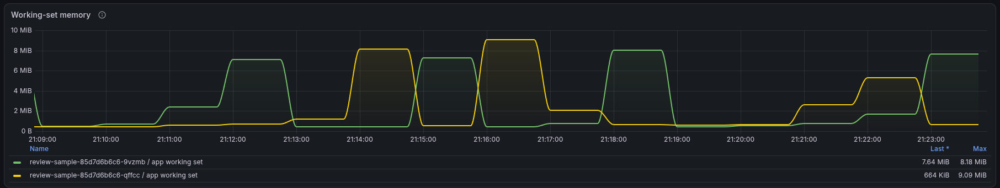

### RSS and cache

Total and working-set memory show the broad level, while **Separate resident memory from file cache** in Chapter 3 uses RSS and cache to explain part of that total. The **RSS and cache** graph keeps both lines visible. RSS mainly shows resident anonymous memory, which often includes heaps and stacks. Cache shows file contents that Linux has kept in memory for reuse and may reclaim later. RSS plus cache does not always equal total memory because the cgroup can charge other memory too.

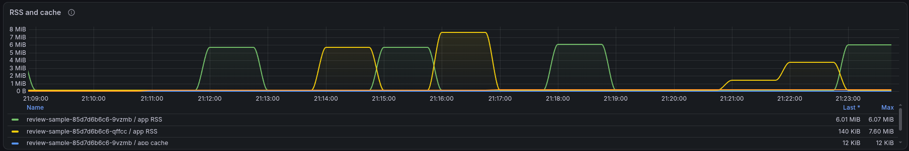

### Maximum values for the selected period

The **Maximum values for the selected period** table shows the highest sampled total, working-set, RSS, and cache value for each Pod UID. These are the largest values Prometheus saved during the selected period. As Chapter 3 explains in **Sampling Trades Detail for Volume**, a short peak between two scrapes can still be missed.

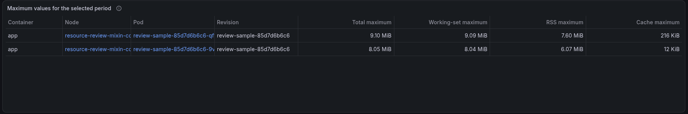

### Memory request and limit

The **Memory request and limit** graph places the two configured values beside each other. Kubernetes uses the request when it schedules the Pod. The limit is the cgroup ceiling; if the container reaches it and Linux cannot reclaim enough memory, an allocation can fail and a process can be killed. A request or limit that was not configured stays empty instead of appearing as zero.

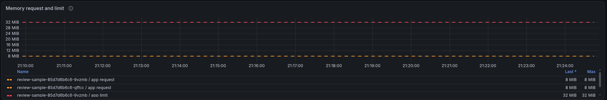

### Memory pressure when PSI metrics exist

Memory can slow a container before an allocation fails. **Measure time lost to memory pressure** in Chapter 3 uses PSI to count time when work could not continue while Linux searched for memory it could reclaim. The **Memory pressure when PSI metrics exist** graph shows that waiting as a percentage of each five-minute window. A container can stay below its limit and still show pressure, and an OOM can happen without a steady rise in pressure.

PSI is optional. When the node does not provide `container_pressure_memory_waiting_seconds_total`, the graph stays empty rather than showing a false zero.

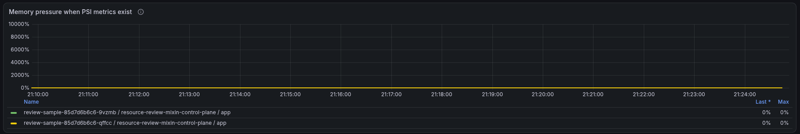

### cAdvisor OOM events

The **cAdvisor OOM events** table shows how many new events `container_oom_events_total` recorded during the selected period. In **Record both sources of OOM evidence**, Chapter 3 uses the same counter to count allocation failures seen by cAdvisor. A value of `2` means cAdvisor recorded about two new OOM events for that Pod and container during the selected time.

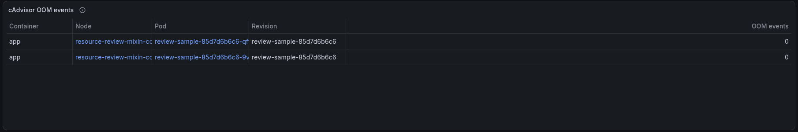

### Kubernetes `OOMKilled` state

cAdvisor's counter is only one side of the check. Kubernetes also stores the last termination reason reported for a container. The **Kubernetes `OOMKilled` state** table shows `True` when `OOMKilled` was seen as that reason during the selected period and `False` when Kubernetes reported another reason. An empty value means Prometheus did not receive the termination-state metric. `True` confirms that Kubernetes saw an OOM kill, but it is not a full count: a later termination can replace the reason.

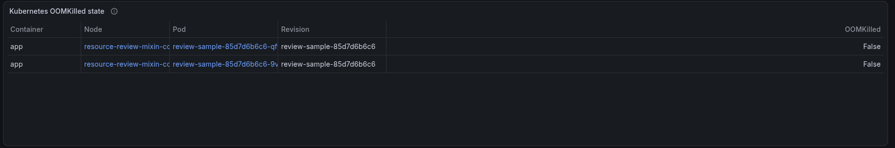

### Container restarts

The **Container restarts** table shows how many times the container restarted during the selected period. A restart count does not say why the restart happened. Read it with the cAdvisor OOM event count and the Kubernetes `OOMKilled` state, then check Pod events and application logs when the cause is still unclear.

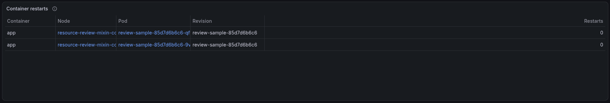

## Replica Comparison

Chapter 3 reaches **Compare replicas before aggregating them** after attaching every measurement to its workload, revision, Pod, and node. The book keeps each replica separate because Pods from the same revision can receive different traffic or run on nodes with different levels of contention. The dashboard follows that order: identify each Pod first, then compare its CPU, memory, waiting, and failure values with the other replicas.

### Keep each Pod and node visible

Both comparison tables keep the **Pod** and **Node** columns visible. The recording rules also retain the Pod UID, so a new Pod cannot inherit measurements from an older Pod that used the same name. The table hides the technical UID column after using it to keep those rows separate.

The first table is **CPU usage, throttling, and pressure by Pod and node**. The second is **Memory, OOM events, and restarts by Pod and node**. Each row belongs to one Pod UID, node, and container from the selected revision.

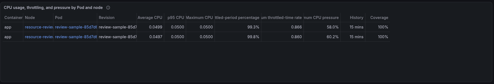

### Compare usage, throttling, pressure, memory, OOM events, and restarts

The CPU table reads the same CPU recording rule three times over the selected period:

```promql
avg_over_time(resource_review:container_cpu_usage_cores:rate5m{namespace="resource-review-test", workload_type="deployment", workload="review-sample"}[$__range])

quantile_over_time(0.95, resource_review:container_cpu_usage_cores:rate5m{namespace="resource-review-test", workload_type="deployment", workload="review-sample"}[$__range])

max_over_time(resource_review:container_cpu_usage_cores:rate5m{namespace="resource-review-test", workload_type="deployment", workload="review-sample"}[$__range])
```

Average, p95, and maximum CPU are calculated separately for every Pod UID. The same row shows the highest throttled-period percentage, throttled-time rate, and CPU-pressure percentage recorded during the selected period. **History** shows how many seconds of samples were available, while **Coverage** compares the number received with the number expected from the one-minute recording interval.

The memory table calculates average and maximum working-set memory separately for the same Pod UID, then adds maximum total memory and maximum five-minute memory-pressure percentage. `increase()` counts new cAdvisor OOM events and container restarts during the selected period. The `OOMKilled` column shows whether Kubernetes reported that last termination reason at any point in the period.

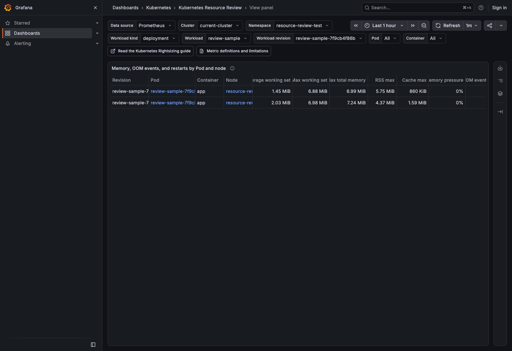

### Do not hide replica differences behind one average

The example in **Compare replicas before aggregating them** shows three Pods with different CPU use, waiting time, throughput, and latency. The Pod on the busy node completes less work and waits longer; averaging its CPU value with the other two would hide that difference.

The **Average CPU** and **Average working set** columns in this dashboard are not workload averages. Each is calculated from one Pod UID's own samples. Pods are never added together or averaged together in Replica Comparison, so a replica with higher throttling, pressure, memory, OOM events, or restarts remains visible beside the others.

## Review Table

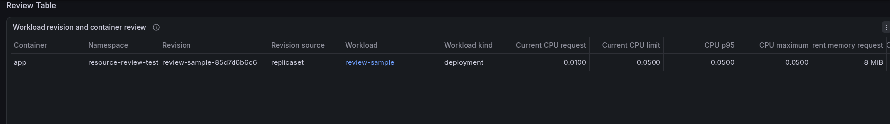

Chapter 3 first keeps workload revisions separate, then compares their Pods before bringing the results into one summary. The **Review Table** follows the same order. It shows one row for each workload revision and container, so values from two releases never become one row. When a mutable image tag produced more than one image ID inside the same revision, the row remains whole and **Missing evidence warnings** reports that difference.

### Current requests and limits

The **Current CPU request**, **Current CPU limit**, **Current memory request**, and **Current memory limit** columns show the last configured value Prometheus saw during the selected period. This keeps a completed or replaced revision readable after its Pods have gone. An empty cell means the request or limit was not configured; it does not mean zero.

Chapter 3's **Interpret usage against the CPU request and limit** section explains why both CPU values stay beside usage: the request affects placement and CPU weight, while the limit sets the quota that can stop the container. The same row keeps the memory request and hard memory limit beside the memory maximum.

### CPU p95 and maximum

Prometheus calculates p95 and maximum CPU separately for every Pod, then the table keeps the highest replica result in the revision row. This preserves the busiest Pod instead of averaging it away. CPU is shown in cores, so `0.5` means half a CPU core.

The p95 comes from five-minute CPU rates collected during the selected period. As Chapter 3 explains under **Sampling Trades Detail for Volume**, this describes the busiest collected intervals, not a microsecond-scale CPU spike.

### Memory maximum

**Memory maximum** is the highest total container memory value seen on any Pod in the revision during the selected period. It uses total cgroup memory rather than working set. Chapter 3's **Measure memory from more than one angle** section explains why the two are not interchangeable: total memory includes all memory charged to the cgroup, while working set subtracts inactive file cache.

Use the Memory Evidence section when you need the working-set, RSS, and cache values behind this summary.

### Absolute and percentage differences from requests

The table compares each request with the busiest value kept in the row:

```text
CPU absolute difference from request    = CPU request - CPU p95
CPU percentage difference from request  = (CPU request - CPU p95) / CPU request

Memory absolute difference from request    = memory request - memory maximum
Memory percentage difference from request  = (memory request - memory maximum) / memory request
```

A negative result means usage was above the request. For example, a `0.50`-core request and `0.60`-core p95 produce `-0.10` cores and `-20%`. These numbers describe the selected period; they do not say that changing the request is safe. The percentage cell stays empty when its request is missing or zero because division by zero has no result.

### Replica count

**Replica count** counts different Pod UIDs seen during the selected period. It includes Pods that were replaced or ran only briefly, so it may be larger than the Deployment's current desired or ready replica count.

This follows **Compare replicas before aggregating them** in Chapter 3: each Pod is measured separately first, and only the highest CPU or memory value is carried into this revision row. Open Replica Comparison to see which Pod and node produced the difference.

### Observation duration

**Observation duration** shows the shortest CPU history among the Pods in the row. Prometheus counts the one-minute CPU rule samples for each Pod and multiplies the smallest count by 60 seconds. If one Pod has seven days of samples and a new Pod has ten minutes, the row shows ten minutes.

Chapter 3's **Make Short Revision History Visible** section explains why this stays next to p95: a p95 calculated from a few minutes cannot describe the same range of workload cycles as one calculated from several days. Missing scrapes also shorten this value.

### OOM, restart, throttling, and pressure signals

The row adds the cAdvisor OOM events and Kubernetes container restarts recorded for all Pods in the revision. **OOMKilled** is true when Kubernetes reported that state for at least one of those Pods. These are separate checks because, as **Record both sources of OOM evidence** explains, the cAdvisor counter and Kubernetes' last termination reason do not contain the same history.

**Throttled-period percentage**, **Throttled-time rate**, **CPU pressure**, and **Memory pressure** keep the highest replica value seen during the selected period. Throttling shows that a CPU limit stopped work; pressure shows that work waited for CPU or memory. PSI cells remain empty on nodes that do not publish PSI metrics.

### Missing evidence warnings

`0` and an empty cell mean different things. Zero means Prometheus received the metric and measured zero. An empty cell means no matching sample was available. The **Missing evidence warnings** column counts different warning types for the row, not the number of Pods that raised the same warning.

The count covers these cases:

- CPU usage is unavailable.
- CPU throttled-period or throttled-time data is unavailable.
- Total memory, working set, RSS, or cache is unavailable.
- Optional CPU or memory PSI data is unavailable.
- A CPU or memory request or limit is not configured.
- The cAdvisor OOM counter or Kubernetes restart counter is unavailable.
- A CPU or memory request is zero, so its percentage cannot be calculated.
- No shared controller revision was found, so the Pod UID is used as the revision.
- One revision and container contains more than one immutable image ID.
- Prometheus collected less than 80 percent of the expected CPU samples.

The warning count keeps a missing value from looking like a measured zero. Use the CPU Evidence, Memory Evidence, and Replica Comparison sections to see the Pod-level values behind the row.

## Find the Pod behind each value

Every value keeps the labels that show where it came from. If one CPU or memory value looks unusual, these labels identify the exact workload, revision, Pod execution, node, container, and image:

```text
cluster
namespace
workload_type
workload
revision
revision_source
pod
uid
node
container
image
image_id
```

For example, one `checkout` container can have these labels:

```text
namespace       = shop
workload_type   = deployment
workload        = checkout
revision        = checkout-7d8f
revision_source = replicaset
pod             = checkout-7d8f-k9m2p
uid             = 2cb4...
node            = worker-2
container       = app
image           = registry.example/checkout:2.4
image_id        = registry.example/checkout@sha256:8ad1...
```

- **`cluster` and `namespace`** locate the workload in Kubernetes.
- **`workload_type` and `workload`** identify the controller, such as the `checkout` Deployment.
- **`revision`** identifies the rollout. For a Deployment, this is usually the ReplicaSet name.
- **`revision_source`** tells you how the mixin found the revision.
- **`pod` and `uid`** identify the Pod. The name is easy to read, while the UID identifies that exact Pod execution.
- **`node` and `container`** show where the container ran and which container produced the value.
- **`image` and `image_id`** show the configured image and the exact image content used by the container. Two Pods can use the same tag and still have different image IDs.

If `revision_source` is `pod_uid`, the mixin could not find a shared controller revision and used the Pod UID instead. Three Pod UIDs then appear as three revision rows, even when they belong to the same workload.

## Find the same value in Prometheus

Grafana reads the values in this dashboard from the recording rules below. You can copy a rule name into Prometheus when you want to inspect its series and add the same labels shown in Grafana to narrow the result:

```promql
resource_review:container_cpu_usage_cores:rate5m{
  namespace="shop",
  workload="checkout"
}
```

| Recording rule | Unit | What it records |
|---|---:|---|
| `resource_review:workload_revision_pod_info` | labels | Workload, revision, Pod UID, and node |
| `resource_review:workload_revision_pod_container_info` | labels | Pod labels plus container, image, and immutable image ID |
| `resource_review:workload_revision_pod_created_timestamp_seconds` | Unix seconds | Pod creation time |
| `resource_review:container_cpu_usage_cores:rate5m` | CPU cores | Average CPU use over five minutes |
| `resource_review:container_cpu_throttled_periods:ratio_rate5m` | ratio | Fraction of CPU quota periods that included throttling |
| `resource_review:container_cpu_throttled_seconds:rate5m` | seconds/second | Throttled task time per wall-clock second |
| `resource_review:container_cpu_pressure_waiting:ratio_rate5m` | ratio | Optional CPU waiting time from PSI |
| `resource_review:container_memory_usage_bytes` | bytes | Total cgroup memory |
| `resource_review:container_memory_working_set_bytes` | bytes | cAdvisor working set |
| `resource_review:container_memory_rss_bytes` | bytes | Resident anonymous memory |
| `resource_review:container_memory_cache_bytes` | bytes | File cache charged to the cgroup |
| `resource_review:container_memory_pressure_waiting:ratio_rate5m` | ratio | Optional memory waiting time from PSI |
| `resource_review:container_cpu_request_cores` | CPU cores | Configured CPU request |
| `resource_review:container_cpu_limit_cores` | CPU cores | Configured CPU limit |
| `resource_review:container_memory_request_bytes` | bytes | Configured memory request |
| `resource_review:container_memory_limit_bytes` | bytes | Configured memory limit |
| `resource_review:container_restarts_total` | counter | Restart count for the exact Pod UID and container |
| `resource_review:container_last_termination_oomkilled` | flag | Whether the latest termination reason was `OOMKilled` |
| `resource_review:container_oom_events_total` | counter | cAdvisor OOM count for the exact Pod UID and container |
| `resource_review:workload_revision_pod_container_qos_class` | label | [Kubernetes QoS class](https://kubernetes.io/docs/concepts/workloads/pods/pod-qos/) for the Pod |
| `resource_review:container_last_terminated_reason` | label | Latest known termination reason |
| `resource_review:container_last_terminated_exit_code` | exit code | Latest known terminated exit code |

The first rules identify the Pod and container. Prometheus then [evaluates the remaining rules in order](https://prometheus.io/docs/prometheus/latest/configuration/recording_rules/) and adds the same labels to the CPU, memory, restart, and OOM values.

## Check application metrics before changing resources

A low CPU or memory value does not automatically mean that you should lower the request or limit. This dashboard shows how the container used its resources.

Before changing a request or limit, note the Pod, revision, node, and time range that produced the value. Run the same workload in a load test, change one value at a time, and compare latency, throughput, and error rate before and after the change.
